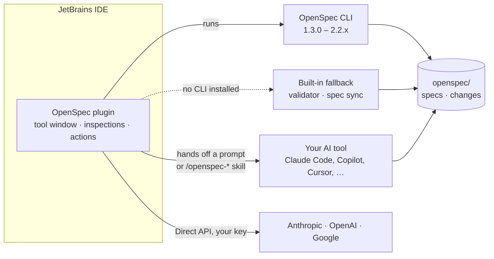
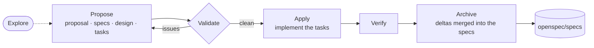

# OpenSpec IntelliJ Plugin

[](https://github.com/johnnyblabs/intellij-openspec/actions/workflows/build.yml)
[](LICENSE)
[](https://plugins.jetbrains.com/plugin/30678-openspec)

<!-- Plugin description -->
An IDE-native client for the [OpenSpec](https://github.com/fission-ai/openspec) spec-driven development framework by [Fission AI](https://github.com/fission-ai). Browse specs, orchestrate the propose → generate → implement → archive lifecycle, and route AI-generated artifacts through the tool of your choice — all without leaving your IDE.

**Features:**

- **Changes browser & Change Deltas pane** — a Changes tree beside a pane that shows what the selected change will add, modify or remove in your specs, with its Validate verdict. Artifact-status badges and task counts on the tree show where each change stands, and Search Everywhere searches requirement and scenario text
- **Validation you can navigate** — real-time editor inspections and quick-fixes matching the OpenSpec CLI's own parser, plus a Validate action (from the toolbar or the Project View context menu, scoped to the clicked change or spec) whose results render grouped by file with clickable file:line links and per-severity coloring
- **Change lifecycle** — create, implement, verify, and archive OpenSpec changes from a dedicated tool window, with schema-aware completeness gates and task-level progress. With OpenSpec CLI 1.5 or later, archiving runs through your CLI's own rules, and a refusal shows the CLI's reason and suggested fix
- **Works with your AI tooling** — detects the AI coding tools OpenSpec supports (87 on OpenSpec 2.1, including Claude Code, GitHub Copilot, Cursor and Gemini CLI), the way the OpenSpec CLI detects them, and hands generation off to the one you already use, or calls the Anthropic, OpenAI, or Google APIs directly with your own key
- **Schema authoring** — fork, create, and validate custom workflow schemas, with template editing and resolution-provenance tags straight from the CLI
- **Stores & worksets** — browse and manage the OpenSpec CLI 1.5 coordination model, with health diagnostics and graceful support back to the 1.4 workspace model
- **Setup wizard** — guided onboarding for new and existing projects; the plugin works with or without the OpenSpec CLI installed and degrades gracefully

Compatible with IntelliJ IDEA, PyCharm, GoLand, WebStorm, RubyMine, and the rest of the JetBrains IDE family, 2024.2 and later. Spec browsing and validation are fully language-agnostic.

Works with OpenSpec CLI 1.3.0 through 2.2.x, targeting 2.2.0, or with no CLI installed.
<!-- Plugin description end -->

> **Maintenance: Living** — updated as part of every relevant change. See the [documentation index](docs/README.md) for the full doc map and each doc's maintenance class.

---

## How it fits together

The plugin is a client for OpenSpec, not a replacement. It runs your OpenSpec CLI when one is installed, falls back to built-in checks when none is, and hands the writing to the AI tool you already use, or to a model API with your own key.



## The change lifecycle

Every change follows OpenSpec's lifecycle. The plugin puts each step one click away and shows where a change stands.



---

## Four Ways to Use It

| Persona | You are... | AI setup? | Get started |
|---------|-----------|-----------|-------------|
| **Spec Browser** | A reviewer, lead, or PM who wants to browse specs | None | [Getting Started](docs/getting-started-browser.md) |
| **IDE-First Developer** | A dev using Copilot, Cursor, Devin Desktop (formerly Windsurf), or Cline inside IntelliJ | None (uses your existing tool) | [Getting Started](docs/getting-started-copilot.md) |
| **CLI Companion** | A dev using Claude Code, Gemini CLI, or another terminal AI | None (uses your existing tool) | [Getting Started](docs/getting-started-cli-companion.md) |
| **Standalone API User** | A dev with an API key who wants a fully self-contained workflow | API key only | [Getting Started](docs/getting-started-api.md) |

---

## Installation

### The plugin

Install from the [JetBrains Marketplace](https://plugins.jetbrains.com/plugin/30678-openspec) (search for **OpenSpec**), or build from source:

```bash
git clone https://github.com/johnnyblabs/intellij-openspec.git
cd intellij-openspec
./gradlew build
# Install from: build/distributions/OpenSpec-*.zip
```

**Requirements:** a JetBrains IDE 2024.2 or later; a Java 21 JDK to build from source.

### The OpenSpec CLI (optional)

The plugin works without the CLI: its built-in validator and spec sync follow OpenSpec 2.2.0's rules, and AI-tool detection is plugin-side. Install the CLI for everything else (the CLI's own validation verdicts, archive, update, stores and worksets) with any of OpenSpec's [install routes](https://openspec.dev/docs/installation):

```bash
# Standalone installer (no Node.js needed), macOS and Linux:
curl -fsSL https://openspec.dev/cli/install.sh | sh
# Windows (PowerShell):
irm https://openspec.dev/cli/install.ps1 | iex
# Or with a package manager:
npm install -g @fission-ai/openspec@latest   # needs Node.js 22.20+
brew install openspec                        # macOS and Linux
```

**Keep one copy of the CLI.** If you install it a second way, your terminal runs whichever comes first in PATH, while the plugin uses the first copy it finds. Upgrade the copy you have the way you installed it: re-run the installer (or `openspec install`), `npm install -g @fission-ai/openspec@latest`, or `brew upgrade openspec`. To pick a specific copy, set **Settings → Tools → OpenSpec → CLI Path**. The plugin's **Update** action runs `openspec update`, which refreshes your project's skills; it doesn't upgrade the CLI.

**Windows note:** npm installs the launcher as `openspec.cmd`, which the plugin finds in `%APPDATA%\npm\` and `%LOCALAPPDATA%\npm\`, plus winget shims. The standalone binary is found where its installer puts it: `~/.local/bin/openspec` on macOS and Linux, `%LOCALAPPDATA%\Programs\openspec\openspec.exe` on Windows. After installing the standalone CLI on Windows, restart the IDE so it sees the new PATH. If auto-detect misses your install, set **CLI Path** to the full location, e.g. `C:\Users\<you>\AppData\Roaming\npm\openspec.cmd`.

---

## Supported OpenSpec CLI versions

**Supported: 1.3.0 through 2.2.x, targeting 2.2.0.** Plugin X.Y supports CLI releases up to X.Y.x, and each new CLI minor gets its own plugin release. The full per-version contract is in [OpenSpec client coverage → Version support](docs/openspec-support.md#version-support).

| CLI | What the plugin does |
|-----|----------------------|
| **2.0.x – 2.2.x** | OpenSpec 2's skills-only layout: skills in `.agents/skills`, linked from each tool's folder, for the project or the whole machine. Update previews the 1.x → 2.x migration. Validation and archive follow each release. [2.x note](docs/cli-versions/2.x.md) |
| **1.15.x – 1.17.x** | Update shows what it will change before applying it. The standalone binary (no Node.js) is detected. |
| **1.5.x – 1.14.x** | Stores and worksets in the Coordination tab, with health and write actions. The built-in validator follows each release's rules. |
| **1.4.x** | The legacy coordination model: workspaces, context stores and initiatives. |
| **1.3.x** | The minimum: the change lifecycle and validation, without coordination. |
| **No CLI** | Spec browsing, the lifecycle tool window, and the built-in validator and spec sync, following 2.2.0. |
| **Below 1.3.0** | A one-time upgrade notice; CLI features are off and the built-in paths take over. |
| **Newer than 2.2.x** | Keeps working, with no warning, until the plugin release for that CLI line. |

---

## Contributing

Contributions are welcome! See [CONTRIBUTING.md](CONTRIBUTING.md) for development setup, coding standards, and PR process.

```bash
./gradlew build      # Compile and run tests
./gradlew runIde     # Launch sandboxed IDE with plugin
./gradlew test       # Tests only
```

CI verifies the plugin on **Windows and macOS in addition to Linux**, so platform-specific behavior — Windows data-dir resolution, backslash/UNC path handling, the `.cmd` launcher shim, and root canonicalization across symlinks and short paths — is exercised on a real host of each OS.

---

## Links

- [Documentation Index](docs/README.md) — Map of every doc: purpose, audience, and maintenance class
- [Feature Reference](docs/feature-reference.md) — Complete reference for all plugin features, settings, and troubleshooting
- [OpenSpec Client Coverage](docs/openspec-support.md) — What the plugin supports vs. the OpenSpec client, by CLI version
- [Feature Comparison Matrix](docs/feature-comparison-matrix.md) — How this plugin compares to VS Code alternatives
- [JetBrains Marketplace](https://plugins.jetbrains.com/plugin/30678-openspec) — Plugin listing
- [OpenSpec Framework](https://github.com/fission-ai/openspec) — The spec-driven development framework by Fission AI
