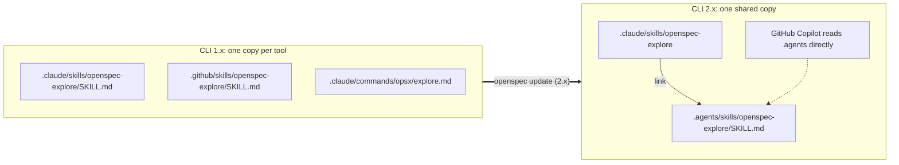

# OpenSpec CLI 2.x — skills layout and plugin support

> **Maintenance: Reference** — the 1.17 → 2.x delta as the plugin supports it (CLI 2.0.0, 2.1.0, 2.1.1, 2.2.0). Plugin 2.2 supports CLI 1.3.0 through 2.2.x and targets 2.2.0.

## What changed

- **Skills only.** OpenSpec 2 no longer writes `/opsx` command files. Each workflow is a skill, invoked as `/openspec-<workflow>` (Codex: `$openspec-<workflow>`).
- **One shared copy.** Skills live once in `.agents/skills/`, listed in `.agents/skills/.openspec-target`. Each tool's own folder links to them, or on Windows holds a copy. Tools that read `.agents` directly need no folder of their own.
- **Machine-wide by default (2.1).** `init --tools` installs skills into `~/.agents/skills` unless given `--scope project`. The plugin passes `--scope project` from 2.1.0, so a project's skills stay with the project.
- **Tools.** The registry grew from 49 to 87 tools in 2.1, and Amazon Q was retired in 2.0.
- **The router skill (2.2).** 2.2.0 adds an `openspec` skill beside the workflow skills, with every profile that has workflows. Ask it when you aren't sure which step comes next: it reads `openspec list` and `status`, says where things stand, and names the next skill. Under a custom profile that lacks a workflow's skill, it can still do that step through the CLI, while the plugin hides the matching action. `openspec update` restores its `references/` files if you edit them.
- **Update migration.** The first `openspec update` with 2.x moves a 1.x project to this layout. 2.1 overwrites or deletes a skill copy you edited without saying so; the plugin's update preview names those files and asks you to back them up first.

## Layout, 1.x to 2.x

## Plugin behavior

- **Skill lookup** finds a workflow's skill through the tool's folder, the shared folder, or the machine-wide `~/.agents/skills`.
- **Manage AI Tools and Settings** say where the skills are: in the project, on this machine, or not installed. A tool that only reads the shared folder shows as set up "via shared .agents skills".
- **Validation and Sync Specs** follow the release in use, or 2.2.0 with no CLI.
- **The update preview** shows the migration as links and moves, and blocks Apply until edited skill files are backed up. From 2.2 that includes the router: its link reads as a link, and an edited router reference is named before the update overwrites it.
