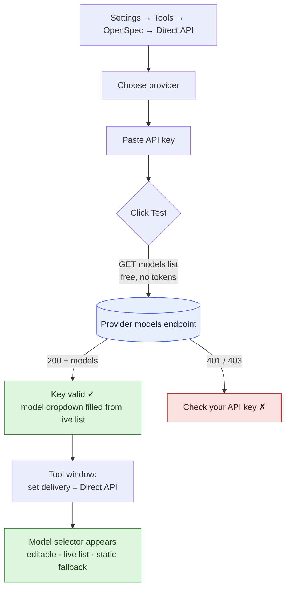
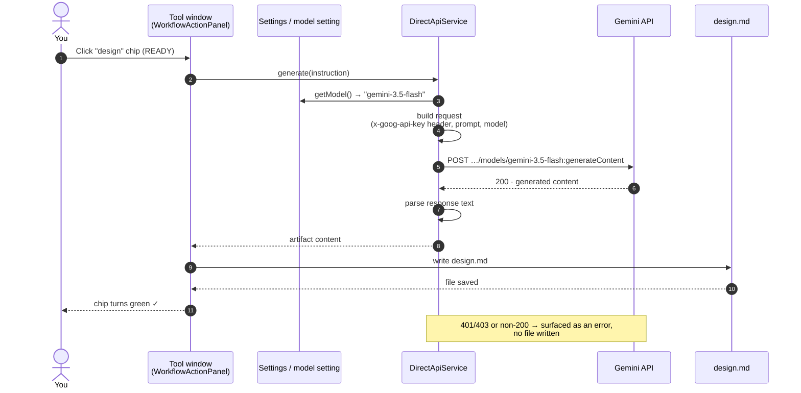
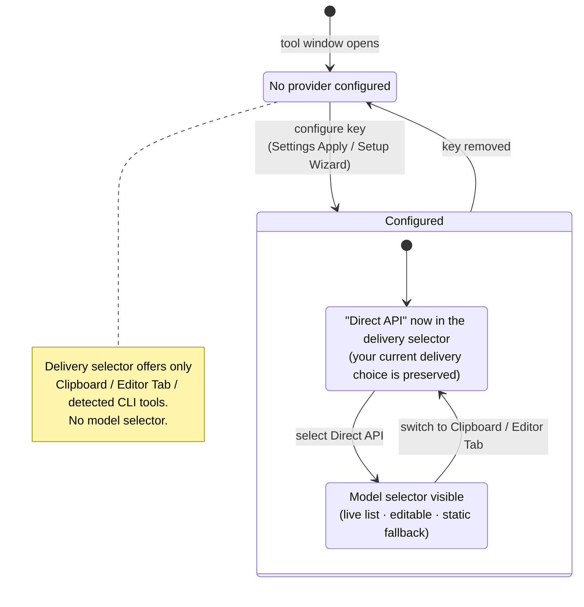

# Direct API — workflow & example

> **Maintenance: Reference** — updated when the Direct API delivery workflow changes.

**Direct API** is one of the plugin's three artifact **delivery methods**. Instead of copying a prompt for you to paste into an external AI tool, the plugin calls your AI provider **directly** with your own API key and writes the generated artifact straight back into the change — a one-click, end-to-end generation flow.

| Delivery method | What happens | Needs a key? |
|---|---|---|
| **Clipboard** | Copies the prompt; you paste it into your AI tool and save the result | No |
| **Editor Tab** | Opens the prompt in a scratch editor tab for you to hand off | No |
| **Direct API** | Plugin calls the provider and writes the artifact itself | **Yes** |

Supported providers: **Claude**, **OpenAI**, **Gemini**.

---

## 1. Set up a provider

Configure the provider once in **Settings → Tools → OpenSpec → Direct API**:

1. **Provider** — pick Claude, OpenAI, or Gemini.
2. **API key** — paste your key. It is stored in the OS credential store (IntelliJ PasswordSafe), never in plain project files.
3. **Test** — validates the key by fetching your account's **live model list** (a read-only request that costs **no tokens**) and fills the model dropdown with the models your account can actually use. A `401` means "check your API key".

Then, in the OpenSpec **tool window** header, set the delivery selector to **`Direct API [API]`**. A **model selector** appears next to it — editable, populated from your live models (with a built-in list as a fallback so it's never empty).

> **Auth is header-based, never in the URL.** Claude uses `x-api-key` (+ `anthropic-version`), OpenAI uses `Authorization: Bearer …`, Gemini uses `x-goog-api-key`. Keys never appear in request URLs or query strings.

---

## 2. Worked example — generate a `design` with Gemini

**Goal:** generate the `design` artifact for a change, using Gemini, without leaving the IDE.

1. Provider = **Gemini**, key tested green (say it listed 40 models).
2. Tool window delivery = **`Direct API [API]`**; model = **`gemini-3.5-flash`** (picked from the dropdown, or typed).
3. Status strip reads: `· gemini-3.5-flash · Direct API`.
4. Select the change, then click its **`design`** pipeline chip (it must be **READY** — a chip that's already **DONE** just opens the file).
5. The chip spins, the plugin calls Gemini, and `design.md` is written and turns the chip **green**.

The selected model is what every Direct API operation uses — chip **Generate**, **Fast-Forward**, **Continue**, and **Explore** — because the selection persists to the model setting the operations resolve through.

---

## 3. When does the model selector show up?

The model selector is **Direct-API-only**: it appears exactly when the active delivery mode is **Direct API** *and* a provider is configured. Because a model has no meaning for Clipboard or Editor-Tab delivery, the selector is hidden there.

Configuration can change **at runtime** — you might open the tool window first and configure the provider afterward. Applying a provider in Settings (or finishing the Setup Wizard) surfaces the Direct API option **immediately**, no IDE restart, and **without changing your current delivery choice** (a new key makes Direct API *available*; you still choose it).

**How "immediately" works:** committing the AI config publishes an application event (`AiConfigListener`) that the tool window listens for; on it, the window rebuilds its delivery selector on the spot. A transition guard on the tool window's normal refresh path is the safety net for any other route. Before this, the delivery selector was built only once (at construction), so a key added afterward stayed invisible until a restart.

---

## Notes

- **Model discovery.** With a key configured, the selector is filled from your provider's **live** model list (fetched off the UI thread with your key). Where a provider marks generation capability per model (Gemini's `supportedGenerationMethods`), the list is filtered to generation-capable models. Offline / no key / fetch failure → a built-in static list, never an empty selector.
- **Editable.** You can always type a model id the list doesn't include.
- **No token cost to set up.** The Test button and the selector's discovery both use the provider's free *list-models* endpoint — not a generation call.
- **Responsiveness.** All credential-store reads/writes and network calls run off the UI thread, so Settings and the tool window never freeze.
