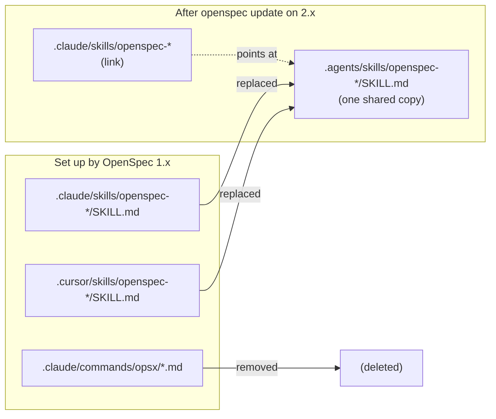

# OpenSpec Plugin — Feature Reference

Complete reference for all plugin features, organized by functional area.

> **Maintenance: Living** — updated as part of every relevant change (see the [documentation index](README.md)). For canonical CLI/plugin version facts, see the [Version support](openspec-support.md#version-support) block.

---

## Browsing & Navigation

### Tool Window

The OpenSpec tool window (right sidebar, or **View > Tool Windows > OpenSpec**) has two permanent tabs, plus conditional Explore and Coordination tabs. Explore, when present, comes right after Browse:

| Tab | Purpose |
|-----|---------|
| **Browse** | Changes-focused master/detail view: a tree of your changes (each with per-artifact status) beside the read-only **Change Deltas** pane, which shows what the selected change will add, modify or remove in your specs (see [Change Deltas Pane](#change-deltas-pane-masterdetail)). Single-click to preview, double-click to open the file, right-click for context menu actions. Specs, archived changes, and `openspec/config.yaml` browse in the standard Project View and open in the editor; spec content search is via Search Everywhere. |
| **Explore** | *(Only when Direct API is configured)* Thinking-space panel with inline topic input, markdown-rendered AI responses, and Copy/Clear toolbar. Appears automatically, right after Browse, when you configure a Direct API provider in Settings. It shows which explore instructions file it used. When Explore isn't in your workflow profile, Send says so instead of sending; if no provider is configured any more, the tab says the prompt was copied, and the input stays usable. |
| **Console** | Output panel for CLI commands (init, validate, update, etc.). |
| **Coordination** | *(Only when OpenSpec 1.4 coordination state or a coordination mode is detected)* Lists workspaces, context stores, and initiatives. See [Coordination Tab](#coordination-tab) below. |

### Coordination Tab

Surfaces the OpenSpec 1.4 coordination layer — **workspaces**, **context stores**, and **initiatives**. It is sourced from the OpenSpec CLI (`workspace`/`context-store`/`initiative list` and `doctor`) with a built-in fallback that reads OpenSpec's global data dir directly (`$XDG_DATA_HOME/openspec`, `~/.local/share/openspec`, or `%LOCALAPPDATA%\openspec`), so a listing still appears without the CLI.

These commands exist only in the OpenSpec CLI **`[1.4.0, 1.5.0)`** window. **CLI 1.5.0 removed them** (replaced by a store/workset model), so on a 1.5.0+ CLI the plugin never invokes them: the tab stands down to read-only Awareness when legacy on-disk state exists, and Hidden otherwise.

The tab presents at one of three tiers:

| Tier | When | Behavior |
|------|------|----------|
| **Hidden** | No coordination state and not in a coordination mode (or CLI ≥ 1.5.0 with no legacy state) | The tab is not shown. |
| **Awareness** | Coordination state detected, but no CLI in the `[1.4.0, 1.5.0)` window (missing, below 1.4, or ≥ 1.5.0) | Read-only listing with status indicators; action buttons disabled. |
| **Full** | Coordination state present and OpenSpec CLI in `[1.4.0, 1.5.0)` | Listing plus initiative-artifact navigation and create/set-up actions. |

- **Workspaces** show a resolution indicator (resolves locally / unresolved).
- **Context stores** show their id and root, plus metadata/git health when `doctor` detail is available.
- **Initiatives** show a lifecycle status badge (`exploring` / `active` / `complete` / `archived`). Each initiative's artifacts — `initiative.yaml`, `requirements.md`, `design.md`, `decisions.md`, `questions.md`, `tasks.md` — open in the editor (double-click; an uncreated artifact reports that it does not exist yet).
- **Actions** (Full tier): **New Initiative**, **Set Up Context Store**, **Set Up Workspace** delegate to the CLI and refresh the listing on success; CLI errors are surfaced. These actions are **version-gated to the `[1.4.0, 1.5.0)` window and self-retiring** — CLI 1.5.0 removed the underlying `initiative` / `context-store` / `workspace` commands, so upgrading to a 1.5 CLI automatically retires them (the tab switches to the store/workset model below).

### Stores & Worksets (OpenSpec 1.5)

OpenSpec CLI **1.5.0** replaced the 1.4 coordination model with **stores** and **worksets**:

- **Stores** are standalone OpenSpec repos you register on your machine.
- **Worksets** are purely local, composed working views over one or more stores.

When the detected CLI is at or above the **`1.5.0`** store floor, the Coordination tab makes stores and worksets the **lead model**, presented **read-only**:

- **Stores** list each store's **id** and **root**, plus health from `store doctor`: whether store metadata is present and valid, whether the store root is a **git repository** (non-git stores are handled without error), and whether its OpenSpec root is **healthy**. Health comes solely from the CLI's own report — on OpenSpec CLI 1.6+, a **fresh store** whose planning directories (`specs`, `changes`, `changes/archive`) don't exist yet is reported healthy and listed **without any error marker**. Health lookups are lazy and run off the UI thread.
- **Worksets** list each workset's **name** with its **members** shown as child rows (member `name` + `path`).
- **Diagnostics** — every 1.5 command returns a uniform diagnostic envelope (`severity`, `code`, `message`, `target`, `fix`). The plugin retains each diagnostic, including the CLI's ready-made **`fix`** suggestion, and shows it as read-only guidance against the affected store. The suggested fix is displayed, never executed.
- **Legacy demotion (no migration).** When both new (stores/worksets) and legacy (workspaces/context-stores/initiatives) state exist on disk at CLI ≥ `1.5.0`, the legacy state is demoted to a muted, read-only **"Legacy (pre-1.5)"** group, shown only when such state actually exists. The plugin never converts legacy state into stores or worksets — it only reflects what the CLI owns.

Sourcing mirrors the rest of the tab: listings come from the OpenSpec CLI (`store list` / `store doctor` / `workset list`), with a **built-in fallback** that reads the global data dir directly (`stores/registry.yaml` and `worksets/worksets.yaml`) when the CLI is unavailable or a payload fails to parse — a parse failure degrades to the on-disk fallback and never throws into the UI. The store gate derives solely from the detected CLI version (the checked-in config-format version is a separate, independent axis and is not consulted).

**Write actions (Full tier).** When the CLI is at or above `1.5.0` and the surface is at the Full tier, a toolbar and a tree right-click menu expose CLI-delegated actions:

- **New Store…** — a dialog collecting a store id and a **folder location** (a path is required), running `store setup`.
- **Register Existing Store…** — registers an already-existing store folder. On OpenSpec CLI 1.6+ a folder that was never a store can be registered even before its planning directories exist; a folder whose `openspec/config.yaml` points at an external store (a `store:` line) is refused, with the CLI's remediation shown.
- **Unregister** — forgets a store's registration without deleting files.
- **Remove…** — *destructive*: forgets the registration **and deletes the store's local folder**; guarded by an explicit confirmation that says so.
- **Open Store Root** — opens the store's OpenSpec root.
- **New Workset…** — a dialog collecting a name and a member list (member folders are never modified), running `workset create`.
- **Open Workset** — reveals the workset's member folders in your file manager, behind an explicit "opens N folders" confirmation; never auto-opens on tab load. (Deeper in-IDE multi-folder integration is a follow-up — the platform's attach-to-project API isn't available across the plugin's minimum supported IDE build.)
- **Remove Workset** — deletes the saved workset; member folders are untouched.

Actions run off the UI thread; on failure the CLI's diagnostic message (and its `fix` suggestion) is surfaced, never raw error output. A `store doctor`-driven **health strip** at the top of the panel shows the highest-severity diagnostic with its `fix` as an inline action. If a **Store Doctor** check can't run or returns nothing readable, it says the store's health couldn't be determined, never that the store is healthy.

### Browse Tab Tree Structure

```
OpenSpec
└── Changes
    └── add-greeting  2/4                ← name-first, dimmed task progress X/Y
        ├── proposal        ● done badge
        ├── design          ● ready badge
        ├── specs (needs: design)  ✕ blocked badge
        └── tasks           ▲ not-created badge
```

> Specs, archived changes, and `openspec/config.yaml` are browsed in the standard Project View (which lists `openspec/**`) and open in the editor — the tool-window tree is dedicated to Changes.

**Artifact status badges.** A change artifact's status is shown as a small badge overlaid on the
node's icon — **done**, **ready**, **blocked**, or **not-created** — rather than as a glyph glued to
the label (labels are now the plain artifact id, keeping a subtle foreground tint as reinforcement).
Badges use distinct shapes, are theme- and HiDPI-correct, and each badged node names its status in
its tooltip. A blocked artifact keeps a `(needs: …)` suffix naming the unmet dependencies. When the
OpenSpec CLI is unavailable, badges degrade honestly to done-versus-not-done (the ready/blocked split
needs the CLI's dependency graph). A **change** node itself shows one of three stages, one badge at a time:

- **No badge:** some artifacts are still missing.
- **Apply-ready (green dot):** all artifacts are complete; tasks may still be open.
- **All tasks done (check mark):** all artifacts are complete **and** every task is done. The label adds
  `· all tasks done` after the count, so finished changes stand out without reading every `X/Y`. This is
  a *suggestion* that the change is ready to archive, not a guarantee: archiving can still be refused,
  for example by spec validation. Run **Verify** to confirm. The label deliberately says "all tasks done"
  rather than "ready to archive", because Verify's "Ready to archive" also checks validation.

The dot and the check differ in shape, so the stages don't rely on color. Without the OpenSpec CLI,
neither badge appears (artifact completion comes from the CLI), while the `X/Y` count still shows.

The change node also shows its task progress as an `X/Y` count in the label when a tasks artifact exists. Tasks are counted exactly as the OpenSpec CLI counts them: any bullet
or numbered marker (`-`, `*`, `+`, `1.`, `1)`), empty or padded boxes (`[]`, `[ x ]`), and done only
when the box holds `x`. The same counts drive the workflow panel, Apply, and Verify.

**On-model boundary.** Only **change**, **change-artifact**, and **missing-artifact** nodes carry a
status badge — these are the nodes with client-owned status (apply-readiness, task progress, and their
combination, all-tasks-done). **Spec,
requirement, delta-spec, and config nodes are never badged**, because the OpenSpec model attaches no
status to a spec or requirement; a badge there would repeat the removed `@spec` coverage scorecard.

The plugin recovers a spec's requirement and scenario counts with a line-oriented scanner that
mirrors the OpenSpec CLI's own parsing, so its reading of a spec agrees with `openspec show` /
`openspec validate`. (The Changes-focused tree no longer renders a Specs section, but this scanner
still backs spec parsing wherever the plugin reads a spec — the consolidated-deltas view and spec
content search.) The recognition rules:

- **Code fences are excluded.** Requirement headers, scenario headers, and normative keywords that
  appear only inside a fenced code block (` ``` ` or `~~~`) are not counted — they are examples, not
  structure.
- **Any level-4 header is a scenario.** Every non-fenced `####` header under a requirement counts as a
  scenario, not only a `#### Scenario:`-labelled one; the bold `**Scenario:**` form is not a scenario.
- **Normative keyword is `SHALL`/`MUST` on the body.** The requirement's normative state is the
  whole-word, case-sensitive keyword `SHALL` or `MUST`, evaluated on the requirement **body** (the lines
  between the header and the first scenario) — not on the header line and not inside fences. `SHOULD` and
  `MAY` are not normative.
- **Requirement headers stay case-insensitive** (see the Spec Format inspection below).

### Change Deltas Pane (master/detail)

The Browse tab is a **master/detail** view: the Changes tree on the left, a read-only **Change
Deltas** pane on the right, in a horizontal splitter whose width is remembered and whose pane can be
collapsed. `Changes` is expanded the first time the tree loads, so your changes are visible at once;
if you collapse it, it stays collapsed when the tree refreshes.

- **What the pane shows.** Every state of the pane starts with a **Change Deltas** header, naming the
  selected change, and one line: *what this change will add, modify or remove in your specs when it's
  archived*. With nothing selected, the pane explains what a change is and how to use it; when the
  project has no changes yet, it offers **Propose a change**.
- **Single-click** a change, or any of its artifacts (proposal, design, tasks or specs, done or not
  yet created), to see that change's deltas. When the artifact is a file that exists, an **Open
  `<file>` in editor** link sits under the header; **double-click** also opens the file. The pane is
  always read-only, and editing stays in the editor.
- **Consolidated change-deltas view.** A read-only, at-a-glance view of everything the change modifies
  at the spec level: a one-line summary (capabilities touched · counts per operation), then each
  capability grouped together, then each operation (`ADDED` / `MODIFIED` / `REMOVED` / `RENAMED`)
  with the same badges as a delta-spec preview, then each requirement's text and scenarios. The
  assembled delta set is sourced from the **OpenSpec CLI** (`openspec show <change>`), never
  hand-assembled from files, and capability groups are shown in a stable alphabetical order. A
  `RENAMED` delta shows its from→to without a requirement body. Each capability section offers a
  **Preview diff** link that opens that capability's delta-vs-current-main diff, so the consolidated
  *reading* view and the per-capability *machine diff* complement each other. A change with no spec
  deltas shows an informative empty state. Under the summary, a one-line legend says what archive
  does with each operation: `ADDED` adds the requirement to the main spec, `MODIFIED` replaces the
  whole requirement (so keep its scenarios), `REMOVED` deletes it, and `RENAMED` renames it and keeps
  its text. The legend appears only when the change has deltas.
- **Validation line.** Under the header, the pane shows the change's verdict from the OpenSpec CLI:
  **Validate: passed** or **Validate: N errors, M warnings**. It is the same run Validate does for
  one change (`openspec validate <change> --type change --json`), so the two never disagree; a
  warning on a change that passes isn't counted, just as Validate doesn't list it. **Show issues**
  runs Validate for that change, and its issues appear where Validate always reports them. The
  verdict is fetched with the deltas and refreshed whenever a file under `openspec/` changes,
  including the main specs it is checked against. If the CLI can't read the change or gives no
  verdict, there's no line.
- **Delta specs.** Selecting a change's delta spec (`changes/<change>/specs/<capability>/spec.md`)
  shows that file, with its operation headers badged. Main capability specs are not previewed in the
  pane; they open in the editor with the platform's Markdown preview.
- **Without the CLI.** Selecting a change or one of its artifacts shows a placeholder saying the
  consolidated deltas need the CLI, still with the header and the open-in-editor link, and a
  **Built-in check** line from the plugin's own validator. It is never labelled "Validate", because
  the built-in check doesn't reproduce every CLI warning. Delta-spec files still preview without the
  CLI.
- **When the CLI can't read a change.** If the CLI is installed but rejects the change, the pane says
  **Can't read this change** and quotes the CLI's reason. That happens for a change with no
  `proposal.md` yet, a renamed or deleted change folder, or a CLI that timed out. It doesn't tell you
  to install the CLI. The result isn't cached, so selecting the change again after fixing it shows its
  deltas.
- **On-model.** The pane renders the delta set the CLI reports, or your own delta-spec markdown. It
  does not synthesize a post-apply "effective" spec, and it does not score or show per-spec/per-delta
  status, progress, or coverage. A change's validity is shown for the change as a whole, as upstream
  validates it. Change-owned state follows the OpenSpec CLI: delta assembly and the validation
  verdict come from the CLI (the built-in check only when there is no CLI), and task progress is counted with the CLI's own task-line grammar, so it matches
  `openspec list --json`.

Rendering runs off the UI thread (the file is read and rendered on a background thread, then the pane
is updated on the UI thread), so selection stays responsive.

### Spec Content Search (Search Everywhere)

Spec content search lives in **Search Everywhere** (double-Shift). Type a term that appears only
inside a requirement's **body or scenario text** — "find where rate-limiting is specified" — and the
contributor surfaces the matching requirement by name, opening its spec in the editor scrolled to
that requirement. It runs off the UI thread over your local `openspec/` files without building or
persisting an index, so it also works while the IDE is indexing.

---

## Workflow Orchestration

### Artifact Pipeline

Each change follows a dependency graph (DAG) of artifacts:

```
proposal  →  design  →  specs  →  tasks
```

The **Workflow Action Panel** (below the tree) displays this as a row of status chips:

| Status | Icon | Meaning |
|--------|------|---------|
| **Done** | Green checkmark | `openspec status` reports the artifact done (its file exists). A done file that still looks like an unfilled template reads `<name> · template` in muted text, with a tooltip pointing to **Regenerate**; nothing is disabled by it |
| **Ready** | Blue filled circle | Dependencies satisfied — ready to generate |
| **Blocked** | Gray empty circle | Waiting on upstream artifacts |

Statuses are exactly what `openspec status` reports. When `openspec status` rejects the selected change (for example, it was renamed or deleted, or its `.openspec.yaml` is invalid), the panel says **Can't read change '<name>'** with the CLI's reason (the full message is in the tooltip), plus **Open .openspec.yaml** and **Refresh** links (Refresh saves your open edits first, since OpenSpec reads the files on disk). The change stays selected, and the card clears on the next refresh once OpenSpec accepts the change again. It doesn't keep showing the old chips. If the CLI couldn't be run at all, the last known status stays. The panel includes a **change selector** dropdown for switching between multiple active changes (the panel acts on the change selected there, not the one selected in the tree), and a **Generate** button that targets the next ready artifact.

**Regenerate.** Right-click a done chip and choose **Regenerate**. One dialog asks **What should change?**, with a note you can leave blank. When completed artifacts depend on this one, the same dialog names them and warns they may become inconsistent. The note is added to this regeneration's prompt only, in every delivery mode, and is never saved. With no note, the prompt is exactly what Regenerate sent before. Over **Generate via API**, a noted regeneration of a single-file artifact also sends the file's current text, so the model revises it instead of starting over. Revising a whole change with your agent is **Revise Change...**.

**Review before Direct API overwrites.** When **Generate via API** regenerates an artifact, nothing is written until you review the result. A dialog lists every file it would write, each compared with the current one; a new file, such as a new capability's spec, is compared with an empty side. **Accept** writes them all as one undoable step. **Reject**, or closing the dialog, writes nothing. If one of the files changes in an editor or on disk while the review is open, Accept writes nothing and says so, so an edit you didn't see is never overwritten. A response the plugin can't use, such as one naming no files, is reported as before and never reviewed. Generating a new artifact, Generate All Remaining and Fast-Forward write without a review, since they don't overwrite anything.

**Local History.** Every Direct API write is marked in the IDE's Local History, so you can see later what a generation changed and get the earlier text back:
- **The label.** Before **Generate via API**, Generate All Remaining, Fast-Forward, Continue or an accepted Regenerate writes, the plugin puts a label: **OpenSpec: before generating `<artifact>`** or **OpenSpec: before regenerating `<artifact>`**. Unsaved edits in the files about to be written are saved first, so the label holds the text you had. A rejected review, or a write refused because a file changed, puts no label.
- **Show Local History.** Right-click a done chip and choose **Show Local History** to open the IDE's own Local History for that artifact's file, or for the change's `specs/` folder from the specs chip. From there you can compare any two points or revert. The item is missing when the file doesn't exist or Local History doesn't track it.
- **Compare with previous.** After an accepted Regenerate that replaced at least one existing file, the confirmation popover offers **Compare with previous**: the text you reviewed against what was written, one file after another for specs. It lasts as long as the popover; afterwards, use **Show Local History**.

The plugin stores no history of its own. Local History is the IDE's, follows its retention setting, and stays on your machine.

**Diff vs current spec.** Right-click the specs chip once it's done and the change has delta specs, and **Diff vs current spec** lists one entry per capability. Each opens the same diff as **Preview Diff**: the current main spec on the left, the change's delta spec on the right, or an empty "New capability — no existing spec" side when there's no main spec yet. After **Generate via API** writes or regenerates the specs, the confirmation popover has the same **Diff vs current spec** link; with several capabilities it asks which one. The diff shows what the change does compared with the current spec, not what the last generation changed. Clipboard and editor-tab delivery don't get the link, since your AI tool hasn't written the specs yet.

### Workflow Actions

| Action | Menu | Description |
|--------|------|-------------|
| **Init** | OpenSpec > Init | Initialize OpenSpec in the current project. Creates `openspec/` directory structure. On CLI 2.1 or later the skills go into the project, not only onto your machine (see [Where the skills are](#where-the-skills-are-cli-21)). If the CLI's init fails, a warning shows the CLI's own message. |
| **Explore** | OpenSpec > Explore... (first in the menu; also on the tool window toolbar, before Propose) | The first step, before a change exists; nothing is created. Prompt for an optional topic, assemble the explore prompt (explore instructions + project context + topic), and deliver via configured delivery mode. The instructions are the explore skill or command OpenSpec generated for your AI tool (your preferred tool in Settings first), so their next-step wording matches your tool. If none is found, the plugin's built-in default is used and you're told so; **Update OpenSpec…** generates the real ones. With Direct API configured, the Explore tab appears in the tool window for inline input and rendered responses, shows which file the instructions came from, and tells the model it can't run commands or change files, so it works from the project context instead. The project context lists every capability by its full id, nested ones like `identity/user-auth` included, and every artifact file of each active change, for any schema: the files OpenSpec reports for each artifact (`openspec status --json`), and the capabilities from `openspec list --specs --json` on CLI 1.7+. Without the CLI, or when it can't answer, the plugin finds the same files itself, skipping dot-files. The prompt is assembled in the background, with a cancellable progress indicator. Clipboard and Editor Tab modes use the topic dialog; Editor Tab opens the prompt in an unsaved tab. When your AI tool has OpenSpec's explore command or skill installed, those two modes hand off just what you'd type to run it, for example `/opsx:explore why caching`, `/opsx-explore …` in Cursor, `@opsx-explore …` in Amazon Q or `$openspec-explore …` in Codex, and the notice says what was copied and where to paste it. The form follows OpenSpec's own rules for your tool and the files it generated. Without them, the full prompt is copied as before. Direct API always gets the full prompt. Wherever the plugin invites you to create a change (the first-change card, the Browse pane and the workflow panel with no changes, the `Changes` node's right-click menu), an **Explore an idea first** link sits beside Propose. Explore also runs while the IDE is indexing. |
| **Explore This Change...** | Right-click an active change | Starts Explore with the change's name as the topic: filled into the topic dialog, or into the Explore tab's input (not sent) when Direct API is the delivery mode. Not offered on specs or delta specs. |
| **Propose** | OpenSpec > Propose... | Does what OpenSpec's `propose` workflow does: describe what you want to build, and you get a change with every artifact it needs before you implement. The dialog's title and the line under the description say which way it will go. **With Direct API**, you can also give the change a name (derived from the description when blank) and, with several schemas, pick one; the plugin creates the change (`openspec new change`, or without the CLI the same `.openspec.yaml` alone), then generates the artifacts needed before apply, with your description as the request, and stops there. The tool window shows the generation, and a schema's artifacts beyond the apply gate are left for you. **With Clipboard or Editor Tab**, it hands your AI tool its own propose workflow with your description: on CLI 2.x the skill (`/openspec-propose …`, `$openspec-propose …` in Codex), on 1.x the skill or command the tool has. The agent picks the name, asks its own questions and writes the artifacts; the plugin creates nothing. If the project has no propose workflow, a notice offers **Update OpenSpec…**. |
| **New Change** | OpenSpec > New Change... | Does what OpenSpec's `new` workflow does: creates a change without any artifact. Give it a name and, with several schemas, a schema; then create the artifacts one at a time, starting with the first (the proposal, for spec-driven), from the workflow panel or with Continue. `new` isn't in the core profile, so on core the action is shown disabled; add `new` to a custom profile to use it. |
| **Fast-Forward** | OpenSpec > Fast-Forward... | Create a change and generate all artifacts needed for implementation in one step via Direct API. What you type under "Describe what you want to build" names the change and is sent with every artifact the run generates, as the request the change is for. Like Propose, a Direct API run stops once the change is ready to apply. The request isn't saved, so later generations work from the artifacts already written. `ff` isn't in the core profile; on core, use Propose, which does the same. |
| **Continue** | OpenSpec > Continue | Continue the active change's next ready artifact. With Direct API the plugin generates it in the IDE. With the Clipboard or Editor Tab it hands the change to your AI tool's continue workflow, as Revise does. With several active changes it asks which one. |
| **Revise Change...** | OpenSpec > Revise Change... (after Continue), right-click an active change (after Explore This Change...), or the edit icon in the workflow panel's header | Hands the change to your AI tool's own OpenSpec update workflow, which revises the change's proposal, specs, design and tasks, checks they still agree, and shows each revision before writing it. A dialog asks **What should change?**; leave it blank and the agent reviews the whole change for coherence. The plugin copies only what you'd type, such as `/opsx:update add-auth drop the export feature`, `/opsx-update …` in Cursor or `$openspec-update-change …` in Codex, by the same rules as Explore's handoff; it never copies the workflow in. Clipboard and Editor Tab deliver it; with Direct API it's copied to the clipboard instead of sent, because the workflow needs an agent that can read files and ask before each write. If no tool has the update workflow installed, nothing is delivered and you're offered **Update OpenSpec…**. From the menu with no change selected, the only active change is used, or you pick one. Not offered on specs or delta specs. Not the same as **Update OpenSpec…**, which refreshes the generated skills and commands. |
| **Apply** | OpenSpec > Apply | Hands the change to your AI tool to implement its tasks. The Clipboard and Editor Tab send the short apply hand-off when your AI tool has the apply skill or command installed, and the full apply prompt otherwise. With Direct API the plugin copies the apply workflow's hand-off for you to paste, as Revise and Explore do. |
| **Verify** | OpenSpec > Verify | Check artifact completeness and task progress. Opens report dialog. With several active changes it asks which one. |
| **Archive** | OpenSpec > Archive | Archive a completed change: with OpenSpec CLI 1.5+ through `openspec archive` (its validation, rules and messages; "Archive Without Syncing" adds `--skip-specs`), otherwise by the plugin, which applies the delta specs and moves the change to `openspec/changes/archive/YYYY-MM-DD-<name>/` (refused if that folder exists). When the change has delta specs not yet in the main specs, it first asks **Sync and Archive** or **Archive Without Syncing**, and says what each does. Runs in the background; a refusal shows the reason and leaves the change active. The button is enabled once every artifact is complete, even with tasks still open, as the CLI allows. With tasks open it opens Verify, which reports them and offers **Archive anyway**. |
| **Bulk Archive** | OpenSpec > Bulk Archive... | Archive multiple completed changes at once with conflict detection, one `openspec archive` call per change with CLI 1.5+. A change OpenSpec would refuse is marked Blocked (or Failed with the CLI's reason) and left untouched. |
| **Sync Specs** | OpenSpec > Sync Specs | Merge delta specs from a completed change into main specs at `openspec/specs/`, by the same rules as `openspec archive`: fenced examples are left alone, names match exactly, and a change OpenSpec would refuse is refused with its reason in the preview, with nothing written. A new capability starts with `# <name> Specification` and OpenSpec's "TBD - created by archiving change …" Purpose, or the delta's own Purpose when it has one. Shows preview dialog. |
| **Update OpenSpec…** | OpenSpec > Update OpenSpec… | Run `openspec update` to refresh the skills and commands OpenSpec generated for your AI tools. Requires CLI. **On CLI 1.15 or later, it first shows what it will change** (see [Update preview](#update-preview)) and runs only when you click **Apply**. When the CLI reports leftover legacy files from its skills migration (it exits 0 but asks for `--force` or an interactive run — neither reachable from the console), the plugin raises a **Review legacy cleanup** notice instead of bare success: every CLI-listed file appears with a checkbox and an open-to-inspect link (the review quotes what the CLI said and starts with no files ticked, since OpenSpec warns to back up custom content first), removal happens through the IDE as a single undoable step (Local History covers it), and a follow-up `openspec update` verifies the result (if that run fails, the plugin says the cleanup couldn't be verified rather than reporting a clean state). If that verification shows the CLI *regenerated* the files (a known inconsistency in some CLI versions' tool integrations), the plugin says so plainly and stops re-nagging until the CLI reports something different. Escape hatches: run interactively in the terminal (the command is copied to the clipboard instead if the Terminal plugin is disabled), or **Not now** (no re-nag while the pending set is unchanged). **The plugin never runs `openspec update --force` on your behalf.** |
| **Manage AI Tools** | OpenSpec > Manage AI Tools... | Set up AI coding agents (Claude Code, Cursor, Copilot…): OpenSpec writes their skills (CLI 2.x) or `/opsx` commands (CLI 1.x) into the project, and the plugin copies prompts for them. The set-up notice passes on the CLI's own setup note for the tool, such as Hermes's. On a 2.x project, a tool whose skills come only from the shared `.agents/skills` folder reads "via shared .agents skills". The tool list loads in the background. Adding or configuring a tool says what it did and, without Direct API, offers **Set up Direct API…** for generating inside the IDE instead. Without the OpenSpec CLI, **Add** creates the tool's folder and makes it your preferred tool. It never touches the CLI's own list of set-up tools (`.agents/skills/.openspec-target`) on a project set up by CLI 2.x. Codex and the universal `.agents` tool can only be recorded in that list, so on a 2.x project, or where the shared folder already belongs to another tool, Add says the CLI is needed instead. The dialog also says where the project's skills are, and can install machine-wide skills into the project (see [Where the skills are](#where-the-skills-are-cli-21)). |
| **List** | OpenSpec > List | List all specs and changes. |
| **Refresh Tree** | OpenSpec > Refresh Tree | Manually refresh the tool window tree. |
| **Setup Wizard** | OpenSpec > Setup Wizard... | Guided onboarding for new projects. |
| **Settings…** | OpenSpec > Settings… (last in the menu; also last on the tool window toolbar) | Opens Settings > Tools > OpenSpec: CLI, delivery and Direct API. Its About line shows the plugin version, the OpenSpec CLI it targets, and the CLI detected on this machine, for bug reports. |

### Profile-Aware Action Visibility

Workflow actions respect the active OpenSpec profile. Actions whose workflow is not enabled in the current profile (e.g., `core` vs expanded) appear **visible but disabled** with a tooltip: *"Requires custom profile. Change in Settings → Tools → OpenSpec."* On the custom profile, the tooltip says the workflow isn't in your custom list and points to **Customize workflows…** instead.

The plugin works out the active workflows the way the OpenSpec CLI does, so it enables exactly what the CLI installs:

| Profile | Active workflows |
|---------|----------------|
| **core** (also when no profile is set) | `propose, explore, apply, update, sync, archive` on CLI 1.6 and later. CLI 1.4–1.5 has no `update`, and CLI 1.3 also has no `sync`. Any workflow list left over in your config is ignored for core, as the CLI ignores it. |
| **custom** | The workflows you picked. On CLI 1.10 and later, `sync` is included whenever you picked `archive` or `bulk-archive`, because archiving needs it. |

Workflow-bound actions are enabled when their workflow is active: Propose, New Change (the `new` workflow), Explore, Revise Change (the `update` workflow), Apply, Archive, Fast-Forward, Continue, Verify and Bulk Archive.

**When your CLI changes.** The active workflows follow the CLI the plugin detects. If you upgrade, downgrade, install or remove the CLI while the IDE is open, the next detection re-checks them, so a workflow the new CLI adds (for example `update`, from CLI 1.6) is enabled without reopening the project, and the status-bar profile updates too.

Utility actions (Init, Validate, List, Refresh, Update OpenSpec…, Manage AI Tools, Setup Wizard, Settings) are always enabled regardless of profile.

The profile is configured globally via `openspec config profile` or in **Settings → Tools → OpenSpec**. After changing the profile, action enablement updates immediately.

**Customize workflows…** (in **Settings → Tools → OpenSpec**, beside the profile) opens the CLI's interactive workflow picker, `openspec config profile`, in a Terminal tab. If the Terminal plugin is disabled, the command is copied to the clipboard instead.

### Scaffolding Detection

Artifact status comes from `openspec status`, so a file OpenSpec considers done is done. If a done file still looks like an unfilled template, its chip reads `<name> · template` with a tooltip pointing to **Regenerate**. Nothing is disabled because of it.

---

## AI Integration & Delivery

### Delivery Modes

When you click Generate, the plugin delivers the assembled prompt via your configured method:

| Mode | What happens |
|------|-------------|
| **Copy for [Tool]** | Copies the prompt to clipboard with tool-specific guidance (e.g., "Paste into GitHub Copilot"). One entry per detected tool. |
| **Open in Editor Tab** | Opens the prompt in an unsaved editor tab for review before pasting into any AI tool. Nothing is written to disk. |
| **Generate via API** | Sends the prompt directly to an AI provider's API and writes the response to disk automatically. Requires an API key. With a provider configured, the button reads **Generate via Claude API** (or OpenAI, Gemini). |

Copying for an agent and Direct API are separate: an agent like Claude Code (set up in **Manage AI Tools**) needs no API key, and the plugin copies prompts for it to paste; Direct API is the plugin calling a provider's API with your own key. Each surface points to the other.

### AI Tool Detection

The plugin knows every AI tool the OpenSpec CLI can set up and detects them the way the CLI does, using the same names as OpenSpec's tool picker. Which tools depends on your CLI: **87** on OpenSpec 2.1, **49** on 2.0 and **50** on 1.17. CLI 2.0 retired Amazon Q, and 2.1 added 38 tools. A representative subset is shown below:

| Detected from | Tool | Type |
|---------------|------|------|
| `.github/copilot-instructions.md`, `.github/prompts/`, `.github/instructions/`, … | GitHub Copilot | IDE Panel |
| `.cursor/` | Cursor | IDE Panel |
| `.devin/` (or the older `.windsurf/`) | Devin Desktop (formerly Windsurf) | IDE Panel |
| `.cline/` | Cline | IDE Panel |
| `.claude/` | Claude Code | CLI |
| `.agents/skills/` (owner recorded in `.agents/skills/.openspec-target`) | Codex, or another tool sharing `.agents` | CLI |

A few rules come straight from the CLI:
- **Copilot is detected only from its own files.** A plain `.github/` folder, which most repositories have, doesn't count.
- **Tools sharing `.agents/`** (Codex, Amp, Antigravity, Zed and others) are told apart by OpenSpec's ownership marker, then by the generated skills. On 2.x the marker is a list of every tool set up, and a skill's wording counts only when the file is exactly one an OpenSpec release generated.
- **Older directories still count:** `.windsurf/`, `.codex/` and `.kimi/`, for example.
- **Tools that install into your home directory** (MiniMax Code) are detected there.
- **Newer tools are hidden from older CLIs, and retired ones from newer CLIs.** The plugin only offers or passes a tool to `openspec init` when your installed CLI accepts it. The 38 tools added in 2.1 appear from CLI 2.1. Amazon Q isn't offered or listed on CLI 2.0 and later, which retired it; `openspec update` (**Update OpenSpec…**) removes OpenSpec's Amazon Q files there and recommends Kiro.
- **The 2.1 tools need the CLI to set up.** They are detected only by OpenSpec skills of their own or the CLI's tool list, so adding one without the CLI says the CLI is needed.
- **Regional variants share a folder** (Trae and Trae CN, Qoder and Qoder CN, Zencoder and Zenflow). As on CLI 2.1, when the tool list names none of them, only the first counts as set up.
- **CLI or IDE badges** come from each tool's own documentation. A 2.1 tool whose documentation doesn't settle it has no badge, and gets the generic paste guidance.
- **Each CLI line keeps its own rules.** OpenSpec 1.x and 2.x can reach different verdicts on the same files: a lone `.gsd/` folder means the shared-folder tool to 1.x but GSD to 2.x, and 2.1 never counts a machine-wide install as a project's tool. The plugin uses the rules of the CLI you have installed. With no CLI installed, it reads the files: a tool list naming several tools, an `own-files` mark, or a tool folder linking into `.agents/skills/` means 2.x rules, and anything else means 1.x rules.

#### Skills on OpenSpec CLI 2.x

From CLI 2.0, OpenSpec writes every tool's skills to one shared folder, `.agents/skills/`. It records the tools it set up in `.agents/skills/.openspec-target`, one per line. A tool that reads its own folder gets a link from there into the shared copy: `.claude/skills/openspec-explore` → `../../.agents/skills/openspec-explore`. Skills-only tools such as Cursor and GitHub Copilot get nothing of their own.

The plugin finds a tool's skill wherever OpenSpec left it, whichever CLI is installed, so Explore, Revise, Continue and Apply hand off to the right tool on 1.x and 2.x projects alike:

1. the shared `.agents/skills/` copy, when `.openspec-target` lists the tool;
2. the tool's own folder, through a link, a copy, or the small text file Git checks a link out as when it can't make links;
3. a 1.x copy in the tool's own folder, or an older folder;
4. skills installed for the whole machine (CLI 2.1's default), under your home directory: the tool's own folder there, or `~/.agents/skills/` for the tool you prefer in Settings.

What a tool's folder holds depends on your system, and each case is handled:

| Your system | A tool's skill folder holds |
|---|---|
| macOS or Linux | a link into `.agents/skills/` |
| Windows, CLI 2.1 | a copy (OpenSpec copies rather than links for projects on Windows, since Git can't carry a Windows link to a teammate) |
| Windows, CLI 2.0, or machine-wide skills | a link when Windows allows it (Developer Mode), otherwise a copy |
| A Windows clone of a project committed from macOS or Linux | a small text file holding the link's target; `openspec update` turns it into a copy |
| Any system, with `.agents/` deleted or not checked out | a link to nothing: the tool still counts as set up, and Update OpenSpec… restores it |

Your home directory is found the way the CLI finds it: `USERPROFILE`, then `HOME`, then Java's `user.home`. Machine-wide skills are read in the background and remembered until the plugin runs `init` or `update`, or you return to the IDE. After the plugin runs `init` or `update`, the skills folders are refreshed in the IDE, so links and folders that changed type show up without a manual refresh.

#### Where the skills are (CLI 2.1)

From CLI 2.1, `openspec init --tools` installs the skills for your whole machine (`~/.agents/skills/`) by default, and writes none into the project. Teammates who clone the repository then get no skills. The plugin keeps a project's skills in the project:

- **Init and the setup wizard** ask for the project scope: `--scope project` on CLI 2.1 or later, plus `OPENSPEC_SKILLS_SCOPE=project`, which a 2.1 CLI honours even when the plugin couldn't read its version. Older CLIs run exactly what they ran before.
- **Adding or configuring a tool** in Manage AI Tools keeps the project where it is: the project scope for a project with its own skills (or none yet), and no scope for a project that uses only your machine's skills, so the CLI leaves those on the machine.
- **The scope line**, in Manage AI Tools and in Settings under OpenSpec CLI, says where the project's skills are: `Skills: in this project (.agents/skills)`, `Skills: on this machine (~/.agents/skills)` or `Skills: not installed`. When `openspec/config.yaml` records `skillsScope: project` (the CLI's `openspec update` writes it when a team keeps project skills), the line says so. The line appears once scope applies: with CLI 2.1 or later, a 2.x project, or skills installed for the machine.
- **Install into this project.** On a project whose skills are only on your machine, Manage AI Tools offers this link on CLI 2.1 or later. It opens a list of tools ticked the way the CLI's own picker ticks it: tools found in the project, tools installed on your machine (such as `~/.claude` or `~/.cursor`), and your preferred AI tool. **Install** runs `openspec init --tools <ticked> --scope project`; **Cancel** changes nothing.
- **`skillsScope` is read, never written.** Any value other than `project` or `global` is flagged in the `config.yaml` editor with the CLI's own warning, and the rest of the config still applies.
- **A failed init isn't silent.** If `openspec init` fails, a warning shows the CLI's message. On CLI 2.1.0, which downloads the skills with Git during init, it adds a note to check Git and the network (2.1.1 doesn't need either). If the CLI already created `openspec/` before failing, that folder is kept; otherwise the plugin's built-in setup runs.

Moving a project's skills from the project to the machine is left to the CLI's `openspec update`, which asks.

Detected tools appear in bold in the settings panel and are available as clipboard delivery targets. **CLI** tools receive save-path hints in the guidance text; **IDE Panel** tools receive paste-target guidance.

### Direct API Providers

| Provider | API endpoint | Key format |
|----------|-------------|------------|
| **Claude** (Anthropic) | `api.anthropic.com` | Starts with `sk-ant-` |
| **OpenAI** | `api.openai.com` | Starts with `sk-` |
| **Gemini** (Google) | `generativelanguage.googleapis.com` | Google API key |

API keys are stored securely in your operating system's keychain via IntelliJ's PasswordSafe — never saved in project files.

**Specs over Direct API.** Generating `specs` writes one delta spec per capability, at `specs/<capability-path>/spec.md`. The model marks each file with its path, the plugin checks every path, and either all the files are written or none are. Prompts for artifacts that depend on the specs, such as `tasks`, include them.

**Claude Workspace ID.** When Claude is the provider, the settings show a **Workspace ID (optional)** field. Fill it in when your Claude API key isn't scoped to a single workspace: such keys must name a workspace on every request, and Claude rejects them otherwise (the plugin then tells you to enter a Workspace ID). Copy the ID, which starts with `wrkspc_`, from **Console → Settings → Workspaces**. Leave it blank for a key that belongs to one workspace. The ID is a regular per-project setting, not a secret, and is never written to OpenSpec project files. Test uses the value currently in the field, even before you click Apply.

**OpenAI Organization ID and Project ID.** When OpenAI is the provider, the settings show **Organization ID (optional)** and **Project ID (optional)**. OpenAI needs them only if you use a legacy user API key or belong to more than one organization; otherwise leave them blank, and OpenAI uses your key's defaults. A filled-in field is sent with every OpenAI request, generation and Test alike, as `OpenAI-Organization` or `OpenAI-Project`; a blank one sends nothing. Find the organization ID under **Settings → Organization → General** (it usually starts with `org-`) and the project ID under **Settings → Project → General** (it starts with `proj_`). A value with a different prefix gets a warning but is still saved and sent, because OpenAI may change its ID formats. Both are regular per-project settings, not secrets, and are never written to OpenSpec project files. Test uses the values currently in the fields, even before you click Apply.

**Gemini doesn't store the plugin's requests.** Every Gemini generation request asks Google not to keep it, by sending `"store": false`. Since 2026-10-26, Google stores `generateContent` requests by default for new paid-tier projects: it keeps them for 55 days and shows them in the project's AI Studio logs. The setting on the request overrides the project's own setting, so the plugin's prompts and the project context they carry are not logged whatever your project's logging setting is. Older projects already default to not storing. The plugin has no setting to turn storage on. Google's logging and its retention are managed in AI Studio. Claude and OpenAI requests carry no such field.

**When a request fails.** The error keeps the provider's own message and adds a suggestion chosen from the error the provider reports, not only its HTTP status:

| What the provider reports | Suggestion |
|---|---|
| A rejected key or missing permission, including Gemini's `400` for an invalid key | Check your API key |
| Gemini refuses the key with `403` (`PERMISSION_DENIED`) | Check your API key, plus a note that Google rejects older keys that aren't restricted to the Gemini API, and blocks them when unused, so a new key from Google AI Studio fixes it. Google doesn't report this case with a distinct error, so the note is a possible cause, not a diagnosis |
| A billing or payment problem: Claude or Gemini `402`, OpenAI `credit_balance_exhausted` | Where to add credits or fix billing in the provider's console. Never "retry", because waiting doesn't fix it |
| A quota, spend or usage limit: Claude's spend cap or your own usage limit, OpenAI's spend and usage-limit codes or `insufficient_quota` | Where to see and raise the limit. Never "retry" |
| A plain rate limit | Wait a moment and retry |
| The provider is overloaded or unavailable (Claude `529`, `503`, other server errors) | Try again shortly |
| OpenAI rejects the project's service tier | Check which service tiers the OpenAI project allows; the plugin requests none, so this means the project's default tier isn't allowed |
| The model isn't found (OpenAI `model_not_found`; a `404` with Claude `not_found_error` or Gemini `NOT_FOUND` naming the model), for example a saved model the provider has since retired | The model is retired or not available to your API key; choose another under **Settings → Tools → OpenSpec → Direct API → Model**, or in the tool window's model selector. The provider's message names the model. A retired model and one your key can't use look the same to the plugin, because the providers answer both alike |

When the response carries a request ID (Claude's `request-id`, OpenAI's `x-request-id`), it ends the error message, as "(request ID: …)", and is written to the IDE log. Quote it to the provider's support. Gemini sends none. The plugin doesn't retry failed requests itself. The suggestion appears wherever the failure is reported: Settings → Test, Generate, Generate All, Fast-Forward, Explore and Verify.

**Model discovery.** The Model dropdown is populated from your provider account, not a hardcoded list. Clicking **Test** fetches your account's available models with your key — a free request that costs no tokens — and fills the dropdown with the models you can actually use; it also validates the key (a `401` means "check your API key"). If you're offline or haven't entered a key, the dropdown falls back to a built-in default list, and it stays editable so you can type any model name manually.

**A saved model the provider no longer lists.** After **Test**, if your provider's model list doesn't include the selected model, a warning under the Model dropdown says so: the model may have been retired, or the provider may send its requests to another model, so choose one from the list. Requests to such a model can still succeed, billed as the model the provider routes them to. The warning only ever reflects the provider's own list: it doesn't appear before you click Test, when Test fails, or once you change the provider, key or ID fields since. It never names a replacement model. Claude's older aliases, such as `claude-sonnet-4-5`, count as listed when the list has their dated model.

**Choosing a model at operation time.** You don't have to open Settings to switch models: the OpenSpec tool window shows a model dropdown in its header (next to the delivery selector) whenever Direct API is the active delivery mode. It's populated from the same live model list, stays editable, shows the active model in the status strip, and your selection is what generation, Fast-Forward, Continue, and Explore use. It's hidden for Clipboard and Editor-Tab delivery, where no model is sent. If you configure a provider while the tool window is already open — in Settings or the Setup Wizard — the Direct API delivery option and this dropdown appear immediately, with no IDE restart, and your current delivery choice is left unchanged.

---

## Editor Integration

### Inspections

Three editor inspections run in real-time as you edit:

| Inspection | Validates |
|------------|----------|
| **Spec Format** | Spec YAML structure (headings, requirement format, scenario format) |
| **Delta Spec Structure** | ADDED/MODIFIED/REMOVED section headers and content |
| **Config Validation** | `openspec/config.yaml` structure and values |

Requirement headers (`### Requirement:`) are recognized **case-insensitively**, matching OpenSpec CLI 1.4+ parsing. When a requirement carries its RFC 2119 keyword only in the header line, the Spec Format inspection reports a targeted warning — *move the keyword onto the requirement body line* — with a quick-fix that inserts the keyword-bearing sentence as the first body line.

### Annotations

- **Spec block syntax highlighting** — Visual distinction for spec content blocks
- **Given-When-Then scenario annotation** — Highlights scenario structure in spec files

### Line Markers

- **Generic line markers** — On spec definitions in spec files

---

## Validation

**OpenSpec menu > Validate** (or toolbar button)

Validates all specs, changes, and config files. A summary notification names the target and its error/warning counts; the full, navigable report lands in the OpenSpec **Console** (see below).

**OpenSpec menu > Validate (Strict)** (or the toolbar Validate dropdown, or Find Action). A per-run strict validation that mirrors the CLI's `openspec validate --strict` — warnings count as failures. Strict is a per-invocation choice, not a persistent setting: the default Validate is unaffected, and a strict run is always disclosed (the summary reads `Validate (strict)`, adds `— strict: warnings count as failures` on a warnings-only failure, and the console echoes `--strict`), so a strict verdict is never a hidden mode. It means the same thing whether or not the CLI is available.

The built-in validator follows a CLI release: the one detected, or the plugin's target release when no CLI is installed. Each rule a release introduced applies only from that release, and `--strict` fails on exactly the warnings that release fails on. When a detected version can't be read, none of these release rules apply.

- **From 1.14.1:** a requirement whose text is over 500 characters, in a main spec or an ADDED delta, is a warning. The text is measured as OpenSpec measures it.
- **From 1.16.0:** a `Scenario:` block with no WHEN (or GIVEN) step or no THEN step is a warning, in main specs and in ADDED and MODIFIED deltas.
- **From 2.1.1:** a MODIFIED requirement whose text grows past 500 characters, beyond the main spec's current text, is a warning, and a YAML front-matter block at the top of a delta spec is accepted and left with the change.

OpenSpec's "not carried into the main spec by archive" warnings stay the CLI's. Without the CLI the fallback is laxer there, never stricter. Sync Specs and the plugin's own archive merge never copy a delta's front matter into a main spec.

| Mode | Behavior |
|------|----------|
| **CLI available** | The CLI's own verdict is authoritative for specs and changes (`openspec validate --all`) — the plugin never reports a spec/change error the CLI wouldn't. The built-in validator still surfaces `config.yaml` guidance (the CLI's `validate` reports no issues about the file's content), but only as non-failing warnings — config never reds a project the CLI reports clean. From OpenSpec 1.16 the CLI does fail validate when `config.yaml` can't be read or isn't valid YAML; Validate then reports that failure with the CLI's message and fix, on a `config.yaml` link. When the CLI answers with something that isn't a verdict (an error response, malformed or truncated JSON, or JSON without results), the built-in validator gives the verdict instead, as if the CLI were absent; such a run is never reported as a pass. |
| **CLI absent** | The built-in validator is the full fallback: spec format, delta-spec structure, and config. A `config.yaml` that can't be read or isn't valid YAML is a non-failing warning here, because CLI versions before 1.16 accept it. Its severities match the CLI's default-mode verdict, so it is never stricter than the CLI — e.g. a missing spec title is a warning, a scenario's missing step is a warning from OpenSpec 1.16 (an info hint before), a requirement with no scenario is an error, a main spec that declares the same requirement name twice is an error (matching OpenSpec 1.8's duplicate-requirement check, scoped to main specs so change deltas are unaffected), a delta spec placed at a change's `specs/` root instead of under a capability folder is an error and a change that requires specs but has none is an error (both matching the CLI's change-delta discovery, unless the change declares `skip_specs`), and (matching OpenSpec 1.8) a body-carrying requirement without `SHALL`/`MUST` is a non-failing warning that `--strict` re-promotes, while a requirement with no body at all is an error. A delta whose only content is a rename written with bare `FROM:`/`TO:` names (without `### Requirement:` headers) is invalid ("no requirement entries parsed"), as in OpenSpec, and an unpaired rename is reported with OpenSpec's wording. |

**Results in the console (grouped, colored, navigable).** The console report opens with a verdict line naming the target (e.g. `Validation FAILED — Change x`) and an error/warning/info count line, then groups issues under a per-file header — files containing an error first, then warning-only, then info-only, and within a file by line. Each issue's location renders as a clickable `file:line` link that opens the file at that line when the path resolves on disk; issues the CLI reports against a non-filesystem identifier degrade to plain, still-colored text rather than a dead link. ERROR, WARNING, and INFO each render in a distinct, theme-driven color, and a clean run shows a concise `✓ Validation PASSED` confirmation. This is the shared report for every Validate surface (toolbar and the Project-View scoped Validate below); file headers are grouping keys only — no per-file valid/invalid verdict is invented.

**Project View context menu > Validate OpenSpec.** Right-click a file under `openspec/` in the standard Project view to validate *its* item in place, scoped to what you clicked: a file under `openspec/specs/<capability>/` validates that spec; a file under an active `openspec/changes/<name>/` validates that change; a file under `openspec/changes/archive/`, the `openspec/` root, or `config.yaml` (and any selection spanning multiple items) falls back to validating the whole project. The menu item appears only when the selection is under `openspec/`. It reuses the same CLI-authoritative pipeline (the CLI call is scoped, e.g. `openspec validate <id> --type change|spec`) and reports to the same console — no per-file valid/invalid verdict is invented.

Validation also runs automatically at phase transitions (e.g., before archive).

---

## Settings & Configuration

Access via **Settings > Tools > OpenSpec** (or **Preferences > Tools > OpenSpec** on macOS).

### CLI

| Setting | Purpose |
|---------|---------|
| **CLI path** | Path to the `openspec` binary. Click **Detect** to auto-find it. |
| **Status** | Shows CLI version when detected, or "not found". While detection is still running, the tool window shows "CLI: detecting…". |

The plugin re-checks the CLI automatically when the project opens, when the OpenSpec tool window is shown, and
when you switch back to the project's IDE window. So a CLI you upgrade while the IDE is running is picked up when
you return to the IDE, without reopening the project. Re-checks happen at most once every 30 seconds.

### General

| Setting | Purpose |
|---------|---------|
| **Schema profile** | Workflow profile: `spec-driven`, `tdd`, `rapid`, or custom. |
| **Auto-refresh** | Automatically refresh the tree when OpenSpec files change on disk. A refresh keeps your selected node, expanded changes and preview. |

### Config Profile

Read-only display of the current profile name and description from `config.yaml`, plus available workflows from the CLI.

### Schemas

| Setting | Purpose |
|---------|---------|
| **Schema list** | Available workflow schemas, each tagged with where it resolves from (`[project]`, `[user]`, `[package]`); a copy that shadows another source says so (e.g. `[project, shadows package]`). Select one as default for new changes. |
| **Fork** | Fork an existing schema to customize it; the new schema's `schema.yaml` opens in the editor. |
| **New** | Create a new schema with the description and artifact types you choose; its `schema.yaml` opens in the editor. |
| **Validate** | Check the selected schema's structure and templates via `openspec schema validate` — structure errors, missing templates, and circular dependencies appear inline below the list. |
| **Open Templates** | Open the selected schema's artifact templates in the editor (paths resolved via `openspec templates`); missing template files are reported, never created. |

Fork, Validate and Open Templates act on the schema selected in the list, and stay disabled until you select one.

> Schema management requires the OpenSpec CLI v1.3.0 or later.

### Tools & Delivery

| Setting | Purpose |
|---------|---------|
| **Detected tools** | AI tools found in your project (shown in bold). |
| **Deliver via** | Unified dropdown: Copy for [Tool], Open in Editor Tab, or Generate via API. |

### Direct API

The section says Direct API is optional, that an agent like Claude Code needs no key, and links **Manage AI Tools…**.

| Setting | Purpose |
|---------|---------|
| **Provider** | `None`, `Claude`, `OpenAI`, or `Gemini`. |
| **API key** | Stored securely in the OS keychain — never in project files. |
| **Model** | Model to use (pre-populated per provider, editable). |
| **Workspace ID (optional)** | Claude only. Needed when your Claude API key isn't scoped to a single workspace; see [Claude Workspace ID](#direct-api-providers). |
| **Organization ID / Project ID (optional)** | OpenAI only. Needed for a legacy user API key or if you belong to more than one organization; see [OpenAI Organization ID and Project ID](#direct-api-providers). |
| **Test** | Verify your API key and connection. |

> An API key is only needed for Direct API delivery. Clipboard and Editor Tab modes work without any API key.

---

## Update preview

On OpenSpec CLI 1.15 or later, every update the plugin starts shows you what it will do first: the **Update OpenSpec…** action, the update offered after you switch workflow profile, and the **Update** button in **Manage AI Tools**. The plugin runs `openspec update --dry-run --json`, which writes nothing, and shows its plan in the **OpenSpec Update Preview** dialog:

- **A summary**, such as "24 changes: 12 deletes, 12 adds".
- **OpenSpec's notes.** A note that the update will move files out of a renamed tool folder (for example `.windsurf/` to `.devin/`) is shown as a warning: run from the IDE, the CLI makes that move without asking.
- **Failures,** for example a file the update can't write. **Apply** is disabled until they're fixed, because `openspec update` stops at the first tool it can't update.
- **The changes, grouped by tool,** with deletes first. Anything outside your project, such as `~/.config/openspec/config.json` (written the first time you update), is in its own **Outside this project** group.

**Apply** runs `openspec update` once. **Cancel** changes nothing. When the plan deletes anything, Cancel is the default button.

- **Nothing to update:** when the plan is empty, the plugin says the project is already up to date and doesn't run the update.
- **The preview fails:** for example there's no `openspec/` folder, or the output can't be read. The plugin shows the CLI's error and changes nothing. It never runs an update you haven't seen.
- **Manage AI Tools:** `openspec update` always updates every configured tool, so the **Update** button there shows the whole plan, with that tool's changes listed first.
- **Legacy cleanup:** when the plan says legacy files are waiting, the plugin takes the list of files to remove from `openspec update --dry-run --force --json` (read-only) after you apply, and offers it in the usual **Review legacy cleanup** flow. Only OpenSpec's own legacy cleanup is offered there, not other deletes in that plan. It never runs `--force` itself.
- **Files from an earlier release (OpenSpec 1.17+):** `openspec update` removes legacy files nobody edited without needing `--force`, so the preview lists them as ordinary deletes in their tool's group, and Cancel is the default. Untouched files that no tool reads any more are grouped as **Left by an earlier OpenSpec release**. If you edited any one legacy file, OpenSpec removes none of them and the **Review legacy cleanup** flow lets you choose.
- **Checking a cleanup:** after you remove legacy files, the plugin checks the result with `openspec update --dry-run --json` (and, while files are still pending, the read-only `--force` plan), which writes nothing. When nothing is left to remove but the update still has changes, the notice offers **Update OpenSpec…**, which opens the preview first. If OpenSpec still notes legacy files but lists none to remove, the notice says so and suggests finishing in a terminal; the plugin never reads a dry run as the CLI regenerating files. Below 1.15 it re-runs `openspec update` as before.
- **Older CLIs:** below 1.15, which has no `--dry-run`, Update runs directly as before.

The plan isn't saved anywhere: each Update asks the CLI again.

### Moving to OpenSpec 2

On a project set up by OpenSpec 1.x, the first `openspec update` with CLI 2.x moves the project to OpenSpec 2. It writes one shared copy of each skill in `.agents/skills`, links each tool folder that needs it (`.claude/skills/openspec-explore` → `.agents/skills/openspec-explore`), deletes the tool folders' own copies, and removes the `/opsx` command files, which OpenSpec 2 no longer uses.



With CLI 2.0 or later, the preview names that move above the changes and groups them as **Shared skills (.agents/skills)**, **Skill copies replaced by the shared copy** and **Command files (OpenSpec 2 installs skills only)**, across tools. Each link is shown as a link to its shared skill.

- **Files OpenSpec can't confirm as its own.** CLI 2.1.0 and 2.1.1 delete or overwrite a skill file you edited, and files you put beside a skill, with no warning and no copy. 2.0.0 keeps them. When the plan would delete or overwrite such a file, the preview lists each one in red, and **Apply** stays disabled until you tick **I've backed up these files**. A file counts as OpenSpec's own when it is exactly one an OpenSpec release generated, or still matches the project's shared copy. Copies written for a custom profile with only a few workflows can show up here although you didn't edit them: OpenSpec can't confirm them either.
- **Notes that reach beyond the project.** On CLI 2.1, when the update will also refresh or remove the skills installed for every project on the machine (`~/.agents/skills`), the preview shows OpenSpec's note as a warning. So does 2.0.0's note that it will replace edits in a shared skill.
- **What the update kept.** After the update, a notification lists the files OpenSpec kept because they differ from what it generated (an edited `/opsx` command file, say), the files it couldn't remove, and on 2.0.0 the skill folders it kept and any edits it replaced, with OpenSpec's own advice and a button to open each file.
- **One notice per project.** When a project still holds skill copies an OpenSpec 1.x release wrote and the CLI is 2.0 or later, the plugin says once, at startup, that **Update** migrates it to OpenSpec 2.
- **CLI 2.1.0 needs Git and a network connection** to install skills. When its update fails for that reason, the plugin says so; 2.1.1 installs offline.
- **No prompts.** The plugin runs every CLI command non-interactively with its input closed. When you choose to run `openspec update` in the terminal instead, CLI 2.1 may ask whether to keep the project's skills in the project or install them globally.

## Troubleshooting

### "CLI: not found" in the status bar

The plugin works without the CLI, but some features (schema management, CLI-enhanced validation, **Update OpenSpec…**) require it.

1. Install it with OpenSpec's standalone installer, which needs no Node.js (`curl -fsSL https://openspec.dev/cli/install.sh | sh` on macOS and Linux, `irm https://openspec.dev/cli/install.ps1 | iex` on Windows), or with `npm install -g @fission-ai/openspec@latest` or `brew install openspec`. See [OpenSpec's installation page](https://openspec.dev/docs/installation)
2. If installed but not detected: **Settings > Tools > OpenSpec > Detect**, or set the path manually
3. On macOS and Linux, an IDE opened from the Dock or a launcher may not inherit your terminal's PATH. The plugin uses the PATH the IDE loaded from your shell, reads your interactive shell's PATH (`~/.zshrc` or `~/.bashrc`) as a fallback, and tries Homebrew paths (including Homebrew on Linux), `/usr/local/bin`, and `~/.local/bin` (where OpenSpec's standalone installer puts it) automatically. On Windows it also checks `%LOCALAPPDATA%\Programs\openspec\openspec.exe`. If you installed the standalone binary with `OPENSPEC_INSTALL_DIR`, the plugin checks that folder only when the IDE's environment carries the variable; otherwise set the path manually
4. Just installed or upgraded the CLI? Switch away from the IDE and back (after 30 seconds) and the status updates on its own
5. If the tool window shows "CLI: detecting…", detection is still running; it updates on its own when it finishes

### Which OpenSpec CLI the plugin uses

OpenSpec can be installed three ways, and each puts the `openspec` program in a different place:

| Route | Where it installs |
|---|---|
| Standalone installer (`install.sh`, `install.ps1` or `openspec install`) | `~/.local/bin/openspec`; on Windows `%LOCALAPPDATA%\Programs\openspec\openspec.exe`. `OPENSPEC_INSTALL_DIR` changes the folder |
| npm (`npm install -g @fission-ai/openspec@latest`) | npm's global folder, e.g. `/opt/homebrew/bin` with Homebrew's Node, `/usr/local/bin`, or `%APPDATA%\npm` on Windows |
| Homebrew (`brew install openspec`) | `/opt/homebrew/bin` (Apple Silicon), `/usr/local/bin` (Intel Macs) or `/home/linuxbrew/.linuxbrew/bin` (Linux) |

The plugin uses the first copy it finds, in this order:
1. the CLI path in Settings;
2. `openspec` on the IDE's PATH (on macOS the IDE loads it from your shell, `~/.zshrc` included);
3. `openspec` on the PATH your interactive login shell sets, so an entry only in `~/.zshrc` or `~/.bashrc` (nvm, fnm, volta, asdf, `~/.local/bin`) is found even when the IDE was opened from the Dock;
4. the Homebrew, system and npm locations;
5. the standalone locations.

Every command the plugin runs keeps the IDE's PATH and gains any of your shell's PATH entries it lacks, so a CLI that needs `node` from a version manager starts too.

Starting an interactive shell can take a few seconds, so the plugin reads your shell's PATH once and reuses it for 10 minutes. After changing your shell setup, press **Detect** in **Settings > Tools > OpenSpec** to read it again. A program your `~/.zshrc` starts in the background, such as an agent or a tmux server, can't hold detection up.

With more than one copy, the plugin normally picks the one your terminal runs, because it looks on the same PATH first. On Windows, an IDE that's already open doesn't see PATH changes until it restarts, so after installing the standalone CLI next to an npm copy, restart the IDE or the plugin keeps using the npm copy. Even so, keep one copy, and upgrade it the way you installed it: re-run the installer (or `openspec install`), `npm install -g @fission-ai/openspec@latest`, or `brew upgrade openspec`. To pin a copy, set its full path in **Settings > Tools > OpenSpec > CLI path**.

The **Update OpenSpec…** action runs `openspec update` (on CLI 1.15+, after showing you the [preview](#update-preview)). That refreshes your project's generated instruction files (skills and commands) to match the CLI you have; it doesn't upgrade the CLI itself.

### "Fast-Forward", "Continue", or other actions are grayed out

**Profile check:** If the tooltip says *"Requires custom profile"*, your active profile doesn't include that workflow. Switch to the custom profile in **Settings → Tools → OpenSpec → Config Profile**. On the custom profile, the tooltip says the workflow isn't in your custom list; add it with **Customize workflows…**.

**API check:** Fast-Forward also requires an AI provider and API key configured in **Settings → Tools → OpenSpec → Direct API**. Propose and Continue need them only with Direct API delivery; with the Clipboard or Editor Tab they hand the change to your AI tool instead, which needs OpenSpec's workflows installed for it (**Update OpenSpec…**). Use the clipboard workflow if you prefer not to configure API keys.

### API test fails

- Verify your API key is correct (Claude: `sk-ant-`, OpenAI: `sk-`, Gemini: a Google API key, either an older `AIza…` key or a newer auth key)
- Gemini refuses the key with a permission error: keys created before late May 2026 that aren't restricted to the Gemini API are rejected, and blocked after a period unused. Create a new key in Google AI Studio; new keys are restricted to the Gemini API by default
- Claude says the key isn't scoped to a workspace, or the workspace wasn't found: enter or correct the **Workspace ID** (starts with `wrkspc_`, from **Console → Settings → Workspaces**)
- OpenAI rejects the key (401) while an **Organization ID** or **Project ID** is filled in: check the key, and that both IDs belong to it, or clear them if you don't need them
- Check that your network allows outbound HTTPS to the provider's API endpoint

### Tree doesn't auto-refresh

Check that **Auto-refresh** is enabled in **Settings > Tools > OpenSpec**. You can always manually refresh with the toolbar button.

### Schema management options are disabled

Schema management (fork, new, validate, templates, default selection) requires the OpenSpec CLI v1.3.0 or later.
