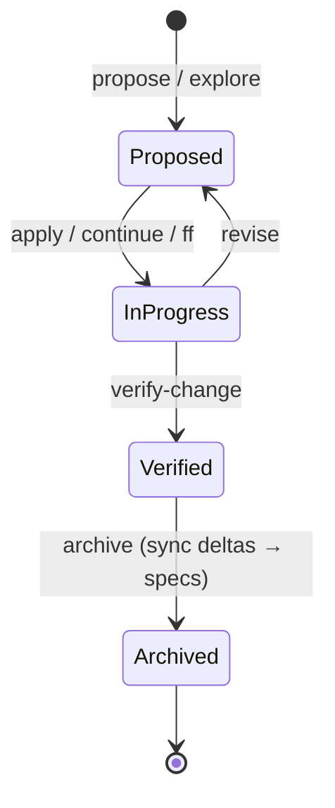

# OpenSpec Client Coverage

How this plugin maps to the [OpenSpec](https://github.com/fission-ai/openspec) client — what's supported, what's partial, and what's on the roadmap. The plugin's goal is to be a **faithful companion to the OpenSpec client**, not a divergent reimplementation, so this matrix is the project's parity north-star.

> **Maintenance: Living** — updated as part of every relevant change (see the [documentation index](README.md)). This doc's [Version support](#version-support) block is the canonical source of truth for CLI/plugin version facts.

**Status:** ✅ Supported · 🟡 Partial · ⚠️ Divergent (reimplemented, being aligned) · 🔜 Planned · 🧩 Plugin-original (no client equivalent)

**CLI column** — the relationship to the installed OpenSpec CLI:
- `built-in` — the plugin implements this itself; works regardless of CLI (even with no CLI installed)
- `1.3+` — needs the CLI floor
- `1.4+` — needs a 1.4-line CLI
- `1.4.x` — exists only in the `[1.4.0, 1.5.0)` window (the command was removed in 1.5.0)
- `delegated` — runs against the CLI at runtime; degrades to a built-in path / guidance below the floor

## Version support

This section is the **single source of truth** for the plugin's per-CLI-version coordination behavior and version facts (current plugin version, minimum/baseline/supported CLI versions). Other docs SHALL link here rather than restating these numbers. Each supported line has an explicit, test-enforced contract (see the per-version behavior contract in `coordination-surfaces`); a change that alters a line's behavior must update this block and its per-version tests.

- **Current plugin version: 0.13.0** (authoritative source: `build.gradle.kts` / the JetBrains Marketplace listing; restated here so other docs have one place to link).
- **Minimum CLI: 1.3.0.** Below the floor, the plugin shows a one-time upgrade nudge and degrades gracefully to its built-in paths (project detection, init, spec browser, tool window, validation).
- **Supported CLI lines: `1.3.x`, `1.4.x`, `1.5.x`, `1.6.x`, `1.7.x`, `1.8.x`, `1.9.x`, `1.10.x`, `1.11.x`, `1.12.x`, `1.13.x`, and `1.14.x`** — each with the per-line contract below. The plugin's built-in **spec** validator matches the CLI's own default verdicts over a shared parity corpus. Validation semantics were stable `1.6.0` → `1.7.0` (byte-identical verdicts), but **1.8 relaxed one rule**: it demoted the missing-`SHALL`/`MUST` check from an error to a **non-failing warning in default mode** for a requirement that has a body (a body-less requirement still errors; `--strict` re-promotes the warning to a failure). The plugin's built-in validator follows that demotion, so its CLI-absent fallback is deliberately laxer on 1.8 than on 1.6/1.7 — never stricter than the client it wraps. This is enforced by a verdict-parity contract test anchored to the **laxest** captured generation (`1.8.0`) plus a cross-generation stability check: in default no generation validates an item the plugin rejects (subset-of-laxest), and under `--strict` no generation validates an item the `1.6.0` strict anchor rejects (every generation through 1.13 reproduces that map exactly; 1.14.2 rejects one item more). Fence-aware keyword/scenario evaluation and the advisory INFO hint for skipped delta headers are unchanged.
- **`1.3.x`:** coordination is below its floor — the Coordination tab is read-only (Awareness) only if legacy on-disk state exists, else Hidden; **no coordination write actions**.
- **`1.4.x` (baseline, tested against 1.4.1):** live coordination reads (`workspace` / `context-store` / `initiative`) **plus IDE write actions** at the Full tier — New Initiative, Set Up Context Store, Set Up Workspace — gated to the `[1.4.0, 1.5.0)` window. These write actions are **self-retiring**: CLI 1.5.0 removed the underlying commands, so they disappear on a 1.5 upgrade.
- **`1.5.x` line:** CLI 1.5.0 replaced the 1.4 coordination commands with the **store / workset** model. The plugin surfaces that model above a `1.5.0` store floor (evaluated from the detected CLI version), with a built-in fallback that reads the global data dir directly. At the Full tier it exposes CLI-delegated **store/workset write actions** (store setup/register/unregister/remove, workset create/open/remove) and a `store doctor`-driven health strip. The legacy 1.4 write actions are not offered here.
- **`1.6.x` line:** the store/workset model and all JSON shapes are unchanged from 1.5, but **store-health semantics changed**: a fresh/config-only store root (no `openspec/specs`, `openspec/changes`, or `openspec/changes/archive` yet) now **registers successfully** and `store doctor` reports it **healthy** with per-directory `present: false` detail — 1.5 refused the same root at register (`store_register_root_unhealthy`, a code 1.6 no longer emits, along with the retired `openspec_{specs,changes,archive}_missing` diagnostics). Registering a root whose `openspec/config.yaml` declares `store:` is refused with new codes (`store_root_pointer_declared`, `invalid_store_pointer`), and registering a never-registered root asks for identity confirmation. The plugin reads health solely from the CLI's own `healthy` flag, so healthy-empty stores list without any error marker, and register refusals surface the CLI's message and `fix` verbatim on either generation. No new gate: the `1.5.0` store floor is unchanged.
- **`1.7.x` line:** the store/workset model and all coordination JSON shapes are **unchanged from 1.5/1.6** — no new coordination gate. 1.7 support is **additive**, and the plugin was aligned to it: a change's `.openspec.yaml` is parsed **leniently** (upstream strips unknown keys), so newer metadata keys — `goal` / `affected_areas` / `initiative` (present since 1.4.1) and the 1.7-new `skip_specs` — are read **display-only** instead of raising a spurious parse-error, and config validation no longer warns on states the CLI accepts clean (a `version:` value it ignores, a missing `schema:` beyond a non-failing INFO nudge, or a custom-forked schema when the CLI known-set is unavailable). The 1.7 config keys `operations.{apply,archive}.guidance` and the global `defaultStore` are **tolerated** (ignored, never flagged), and `status --json`'s new per-artifact `requires` edges parse additively (the plugin keys artifacts by id, so the accompanying schema-order reorder is inert). Verified against captured real 1.7.0 CLI output under `../src/test/resources/fixtures/cli/1.7.0/`.
- **`1.8.x` line:** the store/workset model and all coordination JSON shapes are **unchanged from 1.5–1.7** — no new coordination gate. 1.8's one behavioral change the plugin must mirror is the **missing-`SHALL`/`MUST` demotion**: for a body-carrying requirement the CLI now reports the rule as a non-failing **warning** in default mode (`valid` in default, `valid:false` under `--strict`), while a body-less requirement still errors. The plugin's CLI-absent fallback follows suit — `spec-rfc-keywords` / `spec-rfc-keyword-in-header` are a warning that `--strict` re-promotes, and the verdict-parity anchor moves to `1.8.0` — keeping the fallback never more restrictive than the client. 1.8 also **added** a main-spec duplicate-requirement error — a spec that declares the same `### Requirement:` name twice — which the CLI-absent fallback now mirrors (rule `spec-duplicate-requirement`, an error scoped to the `## Requirements` section of main specs; case-sensitive, N occurrences flag the later N−1), closing a previously under-reported gap. Change **delta** specs keep the CLI's separate delta-consistency rules, which the fallback deliberately does not reimplement — a safe under-report, never an over-report. Everything else is additive: `.openspec.yaml` `retire_capabilities` and `config.yaml` `githubCopilot` keys are **tolerated** (ignored, never flagged), and `status --json`'s new `isPlanningComplete` field parses additively alongside the retained `isComplete` alias the plugin reads. 1.8's expanded agent support — new AI-tool targets and the skills + `opsx` commands split — is **CLI-side file generation into other tools' config directories and is deliberately not surfaced by the plugin**: mirroring the client means not reimplementing its file scaffolding.[^agents] Verified against captured real 1.8.0 CLI output under `../src/test/resources/fixtures/cli/1.8.0/`.
- **`1.9.x` line:** a **strict additive superset of 1.8** — the store/workset model and all coordination JSON shapes are unchanged, and 1.9 introduces **no validation-verdict change**: run against the shared parity corpus, its `validate --all --json` default and `--strict` verdicts are **byte-identical** to `1.8.0`, so the plugin needs no built-in change and the cross-generation parity anchor stays `1.8.0`. 1.9's client-side additions make the CLI *stricter*, never laxer — a new `validate --archived` flag (validates that an archived change's tasks are all complete) and a task-numbering **warning** (duplicate or mismatched task ids) — so the CLI-absent fallback, which validates neither, stays never more restrictive. 1.9 also made root resolution "honest": `validate` / `list --json` run outside an OpenSpec root now return a `no_openspec_root` error (exit 1) instead of an empty result — a shape not reachable through the plugin, which gates CLI invocation on the on-disk `openspec/` root. Verified against captured real 1.9.0 CLI output under `../src/test/resources/fixtures/cli/1.9.0/`.
- **`1.10.x` line:** a **strict additive superset of 1.9** — the store/workset model and all coordination JSON shapes are unchanged, and 1.10 introduces **no validation-verdict change**: its entire validation engine is byte-identical to 1.9 in source, and run against the shared parity corpus its `validate --all --json` default and `--strict` verdicts are byte-identical to `1.8.0`/`1.9.0`, so the plugin needs no built-in change and the cross-generation parity anchor stays `1.8.0`. 1.10's client-side additions are off-model or inert to the plugin: a new `init --language` flag (write scaffolding in a non-English language; spec-validation keywords stay English) and a Zed adapter target (`--tools zed`) are AI-tool/scaffold surfaces the plugin does not reimplement; the first-run shell-completion tip was relocated to **stderr** (deferred on `--json` and non-TTY runs, so it never enters parsed stdout); and a runtime-only `completionTipSeen` global-config field is tolerated (ignored). 1.10 is also the **first two-digit minor version** — the plugin's version comparison is numeric (segment-wise), so `1.10.0` correctly sorts above `1.9.0`, pinned by a dedicated boundary test. Verified against captured real 1.10.0 CLI output under `../src/test/resources/fixtures/cli/1.10.0/`.
- **`1.11.x` line:** an **additive, safe-direction superset of 1.10** — the store/workset model and all coordination JSON shapes are unchanged, and run against the shared parity corpus its `validate --all --json` default and `--strict` verdicts are **byte-identical** to `1.8.0`, so the plugin needs no built-in change and the cross-generation parity anchor stays `1.8.0` (strict anchor `1.6.0`). Unlike 1.9/1.10 the validation-engine source is **not** byte-identical: 1.11 adds one new rule, **`PURPOSE_IS_PLACEHOLDER`** — a main spec whose `## Purpose` opens with a `TBD`/`TODO` marker, or still carries the sentence `openspec archive` writes for a new capability, now gets a **warning** on the spec overview (non-failing in default, a failure under `--strict`). It only makes the CLI *stricter*, so the CLI-absent fallback (which has no placeholder rule) stays never more restrictive, and it is locked against the real CLI by a positive-control fixture. 1.11's other client-side additions are off-model or inert to the plugin: batch `status --all` and `show <change> --diff` render data the plugin's model already holds (its single-change parse is untouched), and an Antigravity adapter directory rename, shell-completion generation, and a transactional `schema init` are AI-tool / CLI-UX / config-write-path surfaces the plugin does not drive. Verified against captured real 1.11.0 CLI output under `../src/test/resources/fixtures/cli/1.11.0/`.

- **`1.12.x` line:** an **additive, safe-direction superset of 1.11** — the store/workset model and all coordination JSON shapes are unchanged, and run against the shared parity corpus its `validate --all --json` default and `--strict` verdicts are **byte-identical** to `1.8.0`, so the plugin needs no built-in change and the cross-generation parity anchor stays `1.8.0` (strict anchor `1.6.0`). 1.12's one new validation behavior is a **verdict-neutral `INFO`**: when validating a change, the CLI now flags a delta whose target main spec does not yet exist — a MODIFIED/RENAMED operation against a missing spec — with an "Archive would refuse this delta…" note. It never contributes to the pass/fail verdict, and the plugin's validate-output parser already surfaces `INFO` at its own severity while taking the verdict from the CLI-authoritative `valid` field, so it is mirrored without a plugin change and locked against the real CLI by a positive-control fixture. 1.12's other client-side additions are off-model or inert to the plugin: an opt-in `validate --report full|findings` selector (a JSON projection the plugin never requests, so the default shape it parses is unchanged), a `codeassistant` AI-tool adapter, and per-surface IDE-restart hint wording. Verified against captured real 1.12.0 CLI output under `../src/test/resources/fixtures/cli/1.12.0/`.
- **`1.13.x` line:** the first line since 1.8 that needed real plugin work, though not a breaking one. The store/workset model is unchanged and every JSON shape the plugin parses is unchanged or only gains keys. Run against the shared parity corpus, `1.13.2`'s default and `--strict` verdicts are **byte-identical** to `1.12.0`, so the parity anchors stay `1.8.0` (default) and `1.6.0` (strict).
  - **Where 1.13 made the client laxer, the plugin follows.** `RENAMED` and `REMOVED` delta entries may now use any bullet (`-`, `*`, `+`). The built-in validator and the Delta Spec inspection accept them; before this they reported a `*`-bulleted rename as an ERROR, which made the fallback stricter than the client. Spec sync now applies bullet-form `REMOVED` entries, and renames written in the client's own form (``FROM: `### Requirement: Old` ``).
  - **Task progress uses the client's 1.13.1 task-line grammar:** any bullet or ordered marker (`*`, `+`, `1.`, `1)`), empty or padded boxes (`[]`, `[ x ]`), and done only when the mark is `x`. The change node's `X/Y`, the workflow panel, Apply and Verify therefore show the same numbers as `openspec list --json`.
  - **A rejected item id is a failed run.** 1.13.1 can answer `validate` with an error response that has no items (`invalid_item`). The plugin used to read that as a pass. It now falls back to the built-in validator.
  - **New 1.13.1 errors are deliberately not adopted.** These are an unpaired `RENAMED FROM:`, a delta file left beside a capability's `spec.md`, a scenario header with no body inside a delta, and a `### Requirement: X ###` duplicate. Each leaves the fallback **laxer** than the client, which the support contract allows; adopting them would make it stricter than the 1.3–1.12 clients it also serves.

  Verified against captured real 1.13.2 CLI output under `../src/test/resources/fixtures/cli/1.13.2/`.

- **`1.14.x` line:** the store/workset model is unchanged, and every JSON shape the plugin parses only gains keys: `show --json` adds `name` on requirements and scenarios, `status --json` and `instructions --json` add an optional `warnings` list, and `instructions apply` adds each task's `sourcePath` and `line`. The plugin's parsers ignore the new keys and read what they read before.
  - **The legacy-cleanup notice was reworded in 1.14.0.** `openspec update`'s "Files to remove" block now says *"These files will be deleted entirely. Back up any custom content before proceeding:"* instead of *"No user content to preserve:"*. The plugin recognizes both. On 1.14+ its review dialog quotes the CLI's warning and starts with nothing ticked; earlier CLIs certified the files as having no user content, so they start ticked.
  - **New 1.14 warnings are deliberately not adopted.** These are an unrecognized `.openspec.yaml` key (1.14.0; lowercase `x-*` keys are exempt from 1.14.2), a requirement over 500 characters (promoted from info to warning in 1.14.1, plus a new delta warning), and text that archiving would not carry into the main spec (1.14.2). All are warnings that only fail under `--strict`. The fallback stays **laxer**, as the support contract allows; when the CLI is present they appear at their own severity.
  - **The strict cross-generation guard is now a subset check.** Over the parity corpus, `1.14.3`'s default verdicts stay within the `1.8.0` anchor's. Under `--strict` it rejects exactly one item more than the `1.6.0` strict anchor: a change whose text before its first requirement archiving would drop. A generation that rejects more never makes the plugin more restrictive, so the guard checks that every generation's strict valid-set is contained in the anchor's, and pins that one divergence.

  Verified against captured real 1.14.3 CLI output under `../src/test/resources/fixtures/cli/1.14.3/`.

[^agents]: The one local footprint is that `openspec update` now also regenerates a `.claude/commands/opsx/` command surface alongside the `.claude/skills/openspec-*/` skills — a CLI-managed developer-tooling detail, not a plugin feature.
- The plugin is **runtime-version-aware**: recognized schema names are the union of its built-in set and the live `openspec schemas` list, and version-sensitive behavior is gated on the detected CLI version.
- **Independent axis:** the checked-in config-format version (a legacy `openspec/config.yaml` `version: 1.2.0`) is *not* the CLI version and is unchanged across CLI 1.2.x / 1.3.x / 1.4.x. The plugin no longer *scaffolds* this field (fresh configs are schema-only, matching `openspec init`), but still *reads* it from a legacy config that carries it.

> Verified by comparing CLI 1.3.1 ↔ 1.4.0: all change-lifecycle workflows (incl. `verify-change`) and the `status` / `instructions` / `templates` / `schemas` / `validate` / `show` commands exist at the 1.3 floor, as do the `schema which` / `schema validate` subcommands (re-verified empirically on 1.3.1, 2026-07-04 — the schema tooling surface needs no gate beyond the 1.3.0 floor). The `workspace-planning` schema and the `workspace` / `context-store` / `initiative` commands are 1.4 additions (see [`cli-versions/1.4.md`](cli-versions/1.4.md) for the cited analysis). The `openspec set` command is **confirmed on the 1.4 line** (verified on a real 1.4.1 CLI, 2026-07-04): `set change <name> --initiative <id> [--store <id> | --store-path <path>] [--json]` links a repo-local change to an initiative — coordination-beta machinery removed in CLI 1.5.0, deliberately given no plugin surface.
>
> **CLI 1.5.0 removed the `workspace` / `context-store` / `initiative` commands and the `workspace-planning` schema** (replaced by the `store` / `workset` model). The plugin's built-in schema set is therefore `spec-driven` only, and coordination is gated to the `[1.4.0, 1.5.0)` window — on a 1.5.0+ CLI the plugin never invokes the removed commands and the Coordination tab stands down (read-only Awareness if legacy on-disk state exists, Hidden otherwise).

## Workflow availability matrix (CLI 1.3.x → 1.14.x)

> `1.9.x`, `1.10.x`, `1.11.x`, `1.12.x`, `1.13.x`, and `1.14.x` are omitted from the columns below. Each is an additive superset of `1.8.x`, with default validation verdicts over the parity corpus identical to 1.8's (1.14's `--strict` rejects one corpus item more): 1.11 adds one new stricter placeholder-`## Purpose` warning, 1.12 one new verdict-neutral archive-blocker INFO, 1.13 laxer bullet parsing plus new errors the fallback stays laxer than, and 1.14 new strict-only warnings the fallback also leaves out. None of these changes a default verdict, so every affordance matches the `1.8.x` column (see the per-line entries above).

A version-oriented view of what each OpenSpec CLI line offers and whether the plugin supports it. **core** = ships in upstream `@fission-ai/openspec`; **custom** = the user opts in via a fork/config (upstream provides the *mechanism*, not the artifact); **removed** = existed earlier, deleted in this line; **n-a** = never existed. Every version boundary below was verified from the actual npm tarballs' `dist/` (1.3.1 / 1.4.1 / 1.5.0 / 1.6.0) and the installed 1.7.0 / 1.8.0, cross-checked against the upstream `CHANGELOG.md`.

> **Core vs. custom, in one line:** *core* is what every install of a line guarantees — the `spec-driven` schema + its four artifacts, the full base workflow set, the line's coordination model, and the `core` workflow profile. *Custom/expanded* is what a user adds on top: forked schemas (`openspec schema fork`), custom workflow profiles, and per-project/per-machine config knobs (`operations.guidance`, `rules`, `references`, `defaultStore`, `skip_specs`). A fork is recognized by the plugin automatically because `SchemaService.getKnownSchemaNames()` unions the built-in floor with the live `openspec schemas` list.

### Schemas (artifact pipelines)

| Affordance | 1.3.x | 1.4.x | 1.5.x | 1.6.x | 1.7.x | 1.8.x | Plugin |
|---|---|---|---|---|---|---|---|
| `spec-driven` schema (proposal→specs→design→tasks) | core | core | core | core | core | core | ✅ built-in fallback + live `schemas --json` |
| `workspace-planning` schema | n-a | core | removed | n-a | n-a | n-a | 🟡 recognized (1.4-window), not authored |
| Custom forks (`schema fork`/`init`/`which`/`validate`) | custom | custom | custom | custom | custom | custom | ✅ full `SchemaService` loop (floor 1.3.0) |

### Workflow skills / commands

| Affordance | 1.3.x | 1.4.x | 1.5.x | 1.6.x | 1.7.x | 1.8.x | Plugin |
|---|---|---|---|---|---|---|---|
| propose · apply-change · archive-change · explore · sync-specs | core | core | core | core | core | core | ✅ built-in actions + AI skills |
| verify-change | core | core | core | core | core | core | 🟡 status-DAG-driven Verify (delegated semantics) |
| onboard · feedback | core | core | core | core | core | core | onboard = plugin wizard · feedback = deliberately not surfaced |
| **update-change** (`/opsx:update`) | n-a | n-a | n-a | core | core | core | ⬜ out-of-model (revise/continue already cover it) |
| static `SKILL.md` publish · `.agents` target · expanded agent set | n-a | n-a | n-a | n-a | core | core | n-a (AI-tool skill-mirror concern; 1.8 added targets/`opsx` commands — off-model) |

### Coordination / multi-change models

| Affordance | 1.3.x | 1.4.x | 1.5.x | 1.6.x | 1.7.x | 1.8.x | Plugin |
|---|---|---|---|---|---|---|---|
| `workspace` / `context-store` / `initiative` (+ `set change`) | n-a | core | removed | n-a | n-a | n-a | ✅ window-gated `[1.4.0, 1.5.0)`, self-retiring writes |
| `store` / `workset` | n-a | n-a | core | core | core | core | ✅ store floor ≥1.5.0, CLI-delegated + on-disk fallback |
| store "healthy-empty" register/doctor semantics | — | — | strict | relaxed | relaxed | relaxed | ✅ reads the CLI's own `healthy` flag |

### Config + profiles

| Affordance | 1.3.x | 1.4.x | 1.5.x | 1.6.x | 1.7.x | 1.8.x | Plugin |
|---|---|---|---|---|---|---|---|
| Global workflow profile `config profile [preset]` (`core`) | core | core | core | core | core | core | ✅ status-bar widget + action gating |
| `config.yaml`: `schema` (req) / `context` / `rules` | core | core | core | core | core | core | ✅ built-in reader/validator (schema = INFO nudge) |
| `config.yaml` `store:` pointer + `references:` | n-a | n-a | core | core | core | core | 🟡 tolerated (ignored, never flagged) |
| `config.yaml` `operations.{apply,archive}.guidance` | n-a | n-a | n-a | n-a | core | core | 🟡 tolerated (not injected — AI-bridge concern) |
| `config.yaml` `githubCopilot` (cloud-agent files) | n-a | n-a | n-a | n-a | n-a | core | ⬜ out-of-model (CLI file-gen preference) |
| Global `defaultStore` | n-a | n-a | n-a | n-a | core | core | ⬜ out-of-model (machine-level store routing) |

### Change metadata (`.openspec.yaml`) + 1.7/1.8 affordances

| Affordance | 1.3.x | 1.4.x | 1.5.x | 1.6.x | 1.7.x | 1.8.x | Plugin |
|---|---|---|---|---|---|---|---|
| `.openspec.yaml` (`schema`, `created`) | n-a¹ | core | core | core | core | core | ✅ lenient parse (strip contract) |
| `goal` / `affected_areas` / `initiative` metadata | n-a | core | core | core | core | core | ✅ read-only (display) |
| `skip_specs: true` | n-a | n-a | n-a | n-a | core | core | ✅ read-only (parsed; archive honoring deferred) |
| `.openspec.yaml` `retire_capabilities` | n-a | n-a | n-a | n-a | n-a | core | 🟡 tolerated (ignored); archive is CLI-delegated |
| `instructions apply` / `instructions archive` | n-a | n-a | n-a | n-a | core | core | ⬜ out-of-model (archive delegates to `openspec archive` on 1.5+, built-in otherwise) |
| `status --json` per-artifact `requires` edges | n-a | n-a | n-a | n-a | core | core | 🟡 parses additively; DAG-from-`requires` is a follow-up |
| `status --json` `isPlanningComplete` (alias of `isComplete`) | n-a | n-a | n-a | n-a | n-a | core | ✅ tolerated; plugin reads `isComplete` |

¹ The `.openspec.yaml` schema file first appears in 1.4.1; on 1.3.x a change has no metadata file.

**Bottom line:** across 1.3.x–1.7.x the plugin needed **no functional validation work** (its runtime is version-aware and already gates/degrades correctly), but **1.8 required real change**: the built-in spec validator's missing-`SHALL`/`MUST` rule was demoted to a non-failing default warning (with a `--strict` re-promotion for a body-carrying requirement; a body-less one still errors), the cross-generation parity guard was re-anchored to `1.8.0`, and the fallback gained 1.8's new main-spec duplicate-requirement error (`spec-duplicate-requirement`, scoped to `## Requirements`) — so the CLI-absent fallback stays never-more-restrictive than 1.8, fixture-backed under `../src/test/resources/fixtures/cli/1.8.0/`. The same pass closed two **change-delta discovery** gaps the fallback had under-reported since earlier lines (surfaced while wrapping up 1.8): a delta spec written at a change's `specs/` root is now flagged (the CLI's misplaced-delta error, shipped upstream in 1.7.0 — the apply/archive merge silently drops such a file), and a change that requires specs but has none is flagged (`delta-none-found`), with delta discovery made recursive (nested multi-segment capability paths are validated) and `skip_specs` honored — so the fallback matches the CLI's change verdict, not just its spec verdict. 1.7's additive surfaces remain aligned (lenient `.openspec.yaml` parse + `skip_specs`; config-validator relaxations); 1.8's other new keys (`retire_capabilities`, `githubCopilot`, `isPlanningComplete`) are tolerated. The ⬜ rows are intentionally out-of-model (AI-tool skill mirrors, agent-instruction injection, machine-level store routing, expanded agent file-generation) — surfacing them would reimplement the CLI or invent state the client doesn't expose in the IDE. **1.9.x** support is pure capture-and-declare — a strict additive superset of 1.8 (byte-identical default and strict verdicts over the parity corpus), needing no functional work; the new `1.9.0` fixtures are a forward tripwire (`../src/test/resources/fixtures/cli/1.9.0/`) and the parity anchor stays `1.8.0`. **1.10.x** is the same — a strict additive superset of 1.9 (validation engine byte-identical in source; default and strict verdicts unchanged), needing no functional work; the `1.10.0` fixtures are a forward tripwire (`../src/test/resources/fixtures/cli/1.10.0/`) and the parity anchor stays `1.8.0`. 1.10 is also the first two-digit minor, so the plugin's numeric version comparison is explicitly tested to order `1.10.0` above `1.9.0`. **1.11.x** is the same shape — an additive, safe-direction superset of 1.10 needing no functional work; its default and strict verdicts over the parity corpus are byte-identical to 1.8, and its one new rule (a placeholder `## Purpose` warning) only makes the CLI stricter, locked by a positive-control fixture (`../src/test/resources/fixtures/cli/1.11.0/`) with the parity anchor still `1.8.0` and the two-digit ordering (`1.11.0` above `1.10.0`) explicitly tested. **1.12.x** is the same shape again — an additive, safe-direction superset of 1.11 needing no functional work; its default and strict verdicts over the parity corpus are byte-identical to 1.8, and its one new diagnostic (a verdict-neutral archive-blocker INFO on a change whose delta targets a not-yet-existing spec) is already surfaced at the correct severity by the parser and locked by a positive-control fixture (`../src/test/resources/fixtures/cli/1.12.0/`), with the parity anchor still `1.8.0` and the anti-lexical ordering (`1.12.0` above the single-digit-minor `1.9.0`) explicitly tested. **1.13.x** needed real but non-breaking work. Its parity-corpus verdicts are byte-identical to 1.12. Where it made the client laxer (any bullet in `RENAMED`/`REMOVED`), the validator, inspection and spec sync follow. Task progress was ported to the client's widened task-line grammar, and an item-less `invalid_item` response now falls back instead of reading as a pass. Its new stricter errors are deliberately left out, so the fallback stays never-more-restrictive. Each behavior is locked by a positive-control fixture (`../src/test/resources/fixtures/cli/1.13.2/`). **1.14.x** needed one functional fix: 1.14.0 reworded the legacy-cleanup notice in `openspec update`, which the plugin's parser no longer recognized, so the cleanup prompt never appeared; it now recognizes both wordings and follows the CLI's new back-up warning. Otherwise its output is additive, and its new warnings, which only fail under `--strict`, are left out of the fallback. Its `--strict` verdicts reject one parity-corpus item more than the strict anchor, so the strict guard became a subset check with that divergence pinned. Each new warning is locked by a positive-control fixture (`../src/test/resources/fixtures/cli/1.14.3/`).

## Change-lifecycle workflows

| Workflow | Status | CLI | Notes |
|----------|--------|-----|-------|
| propose / new | ✅ | built-in | Without the CLI, writes what `openspec new change` creates (settings, proposal, empty `specs/`) + AI skill |
| explore | ✅ | built-in · `instructions` | Thinking-space panel + AI skill |
| apply-change | ✅ | built-in · `status` | Implement-tasks action + AI skill |
| continue-change | ✅ | built-in · `status` | Resume action |
| ff-change | ✅ | built-in | Fast-forward action |
| sync-specs | ✅ | built-in | Built-in delta→main spec sync + AI skill |
| archive-change | ✅ | `1.5+` · `delegated` | Archive action runs `openspec archive` on CLI 1.5+; otherwise built-in (applies deltas, moves to `changes/archive/YYYY-MM-DD-<name>/`) + AI skill |
| bulk-archive | ✅ | `1.5+` · `delegated` | Bulk archive action; one `openspec archive` per change on CLI 1.5+; changes OpenSpec would refuse are held back as Blocked |
| **verify-change** | 🟡 | `1.3+` · `delegated` | Rebuilt to be schema/mode-aware (drives off `openspec status` — the `actionContext.mode` gate *and* the artifact-level completeness check, which reads the status DAG's own artifact set instead of assuming a fixed spec-driven layout; task-checkbox granularity stays locally parsed from `tasks.md`, and a filesystem fallback covers CLI-less environments) and **language-agnostic**: semantic correctness/coherence is delegated to the AI bridge. Non-default modes (e.g. `workspace-planning`) explain and stop. The old Java-only code heuristic is retired. |
| onboard | 🟡 | built-in | Plugin's own Setup Wizard, not the OpenSpec `onboard` workflow |
| feedback | — | n/a | **Deliberately not surfaced** (decision 2026-07-04): `openspec feedback` reaches the upstream framework maintainers, but an in-IDE button reads as plugin feedback — channel confusion in both directions. Terminal users run `openspec feedback` directly; plugin feedback belongs on the plugin's issue tracker. Do not re-propose without revisiting the recorded decision. |

## Model & CLI surfaces

| Surface | Status | CLI | Notes |
|---------|--------|-----|-------|
| init / update / list / show | ✅ | built-in · `delegated` | Actions + tool-window tree. `update`'s skills-migration "legacy files pending" outcome (exit 0 + `--force`/interactive ask) gets a graceful in-IDE resolution: consented per-file removal via undoable VFS ops, terminal handoff, no-nag dismissal, and truthful loop detection when the CLI regenerates the files it flags. The plugin never runs `update --force` on the user's behalf. |
| validate | ✅ | built-in | Built-in delta-spec + config validation, aligned to the client's rules — including the two permanent CLI 1.4.0 parser/validator behaviors: requirement headers are recognized **case-insensitively** everywhere the plugin parses them, and an RFC 2119 keyword appearing only in a requirement's header gets the CLI's targeted "move the keyword onto the requirement body line" diagnostic (`spec-rfc-keyword-in-header`) with a quick-fix |
| delta specs (ADDED/MODIFIED/REMOVED/RENAMED) | ✅ | built-in | Create / inspect / diff / sync. All four delta types (incl. `RENAMED`) were introduced upstream in **1.0.0**, well below the plugin's floor; implemented built-in (works at the floor). |
| status | ✅ | `1.3+` | Used by apply/continue/list and Verify (mode gate + artifact-level completeness, with a filesystem fallback below the floor) |
| instructions | 🟡 | `1.3+` | Used by Explore; not yet broadly |
| view (dashboard) | 🟡 | built-in | Plugin tool-window tree rather than the CLI `view` dashboard |
| templates | ✅ | `1.3+` · `delegated` | Open Templates action in Settings resolves each artifact's template via `templates --json` and opens it in the editor |

## Schemas & profiles

| Capability | Status | CLI | Notes |
|------------|--------|-----|-------|
| `spec-driven` schema | ✅ | `1.3+` | Fully supported |
| `workspace-planning` schema | 🟡 | `1.4+` | Recognized & validated; workflow surfaces detect and reflect the active `actionContext.mode`, and Verify mode-gates it (explains repo-local verify N/A). Full per-mode authoring UX still in progress |
| custom / forked schemas | ✅ | `1.3+` | A forked schema name is recognized rather than flagged unknown; full authoring loop in Settings — fork/create, **Validate** (`schema validate --json`, problems rendered inline), resolution provenance (`schema which --json`, origin tag incl. shadowing), and Open Templates |
| profiles / config | ✅ | `delegated` | CLI-aligned profile picker; config validation |

## Coordination layers

> **1.4-line client commands** (`workspace` / `context-store` / `initiative`), surfaced by the plugin's **Coordination** tab — CLI-sourced (`list`/`doctor`) within the window `[1.4.0, 1.5.0)`, with a built-in fallback that reads the global data dir directly. **CLI 1.5.0 removed these commands** (replaced by the store/workset model), so on a 1.5.0+ CLI the plugin never invokes them: the tab stands down to read-only Awareness when legacy on-disk state exists, and Hidden otherwise. The tab is shown only when coordination state or a coordination mode is detected.

| Capability | Status | CLI | Notes |
|------------|--------|-----|-------|
| workspace | ✅ | `1.4.x` | Listed with resolution health; set-up action (Full tier); read-only fallback from the on-disk registry. Removed in CLI 1.5.0 → tab stands down. |
| context-store | ✅ | `1.4.x` | Listed with id/root and doctor health; set-up action (Full tier — the 1.4 line has no register action in the plugin; register/unregister/remove exist only for 1.5 stores); read-only fallback. Removed in CLI 1.5.0 → tab stands down. |
| initiative | ✅ | `1.4.x` | Listed with lifecycle status badge; artifacts open in the editor; create action (Full tier); read-only fallback from `initiative.yaml`. Removed in CLI 1.5.0 → tab stands down. |

## Stores & worksets (1.5)

> **1.5-line client model** (`store` / `workset`), replacing the 1.4 coordination layer. Surfaced by the Coordination tab when the detected CLI is at or above the `1.5.0` store floor — CLI-sourced (`store list` / `store doctor` / `workset list`) with a built-in fallback that reads the global data dir directly (`stores/registry.yaml`, `worksets/worksets.yaml`). The store registry is byte-identical in shape to the 1.4 context-store registry, so the same backend-local-path reader serves both. At CLI ≥ `1.5.0`, stores/worksets are the lead model and any surviving pre-1.5 state is demoted to a muted, read-only "Legacy (pre-1.5)" group. At the **Full tier** the tab exposes CLI-delegated **write actions** (New/Register/Unregister/Remove store — Remove is guarded as destructive; New/Open/Remove workset) plus a `store doctor`-driven health strip surfacing each diagnostic's `fix`. The plugin performs no migration.

| Capability | Status | CLI | Notes |
|------------|--------|-----|-------|
| store | ✅ 🧩 | `1.5+` · `built-in` | Listed with id/root and `store doctor` health (metadata present/valid, git repository, openspec-root healthy). Health is read solely from the CLI's `healthy` flag — on CLI 1.6+ a fresh store whose planning directories don't exist yet is healthy ("healthy-empty") and shows no error marker. CLI-sourced above the `1.5.0` floor; `built-in` on-disk fallback reads `stores/registry.yaml`. Full-tier actions: New (needs a path picker), Register (1.6 refusal codes for `store:`-pointer roots surface the CLI's fix verbatim), Unregister, and Remove (guarded — deletes local files). |
| workset | ✅ 🧩 | `1.5+` · `built-in` | Listed with members (`name` + `path`) as child rows. CLI-sourced above the `1.5.0` floor; `built-in` on-disk fallback reads `worksets/worksets.yaml`. Full-tier actions: New (member list), Open (opens members as attached folders), Remove (member folders untouched). |

## IDE value-add (plugin-original)

| Capability | Status | Notes |
|------------|--------|-------|
| Spec syntax highlighting | ✅ 🧩 | RFC-2119 + scenario keyword highlighting |
| Delta-spec inline inspection | ✅ 🧩 | Real-time structural checks + quick-fixes |
| Delta-spec diff viewer | ✅ 🧩 | Side-by-side delta vs main spec |
| Tool-window workflow panel | ✅ 🧩 | Change tree + workflow actions |
| Coordination tab (1.4) | ✅ 🧩 | Tiered Hidden/Awareness/Full surface for workspaces, context stores, initiatives |
| Store/workset surface (1.5) | ✅ 🧩 | Tab presentation of 1.5 stores (with `doctor` health) and worksets, gated at the `1.5.0` floor, with legacy pre-1.5 state demoted; at the Full tier, CLI-delegated write actions (store setup/register/unregister/remove, workset create/open/remove) plus a `store doctor` health strip |
| Setup wizard | ✅ 🧩 | Guided onboarding & CLI detection |

## Lifecycle at a glance

## Roadmap

The frontier, in dependency order:

1. **Foundation — schema/version awareness.** Make workflow surfaces drive off `openspec status` / `instructions` (the schema + `actionContext.mode`) instead of assuming a `spec-driven` layout. Unblocks faithful Verify and correct behavior on non-default schemas.
2. **Workflow-surface fidelity.** Rebuild **Verify** as a faithful `verify-change` surface (semantic, language-agnostic, schema-aware); fill remaining workflow gaps (an `onboard`-aligned path; `feedback` was deliberately declined — see its row).
3. **Coordination layers (1.4).** ✅ Shipped — the Coordination tab surfaces `workspace` / `context-store` / `initiative` for cross-area / multi-repo coordination (read-only without a 1.4 CLI; actions and artifact navigation with one). Remaining polish: per-mode authoring UX and richer initiative editing.

> Each row's "delivered by" history lives in [`CHANGELOG.md`](../CHANGELOG.md) and the archived OpenSpec changes under `openspec/changes/archive/`.
